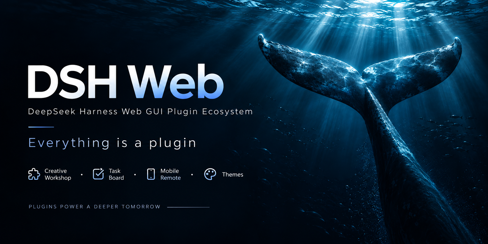
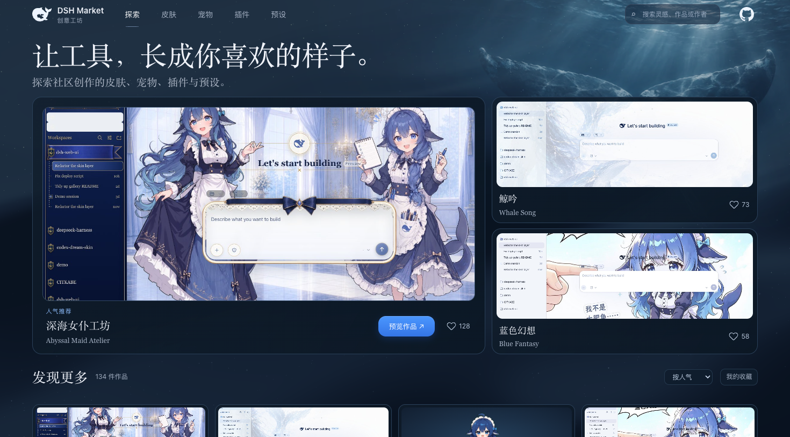
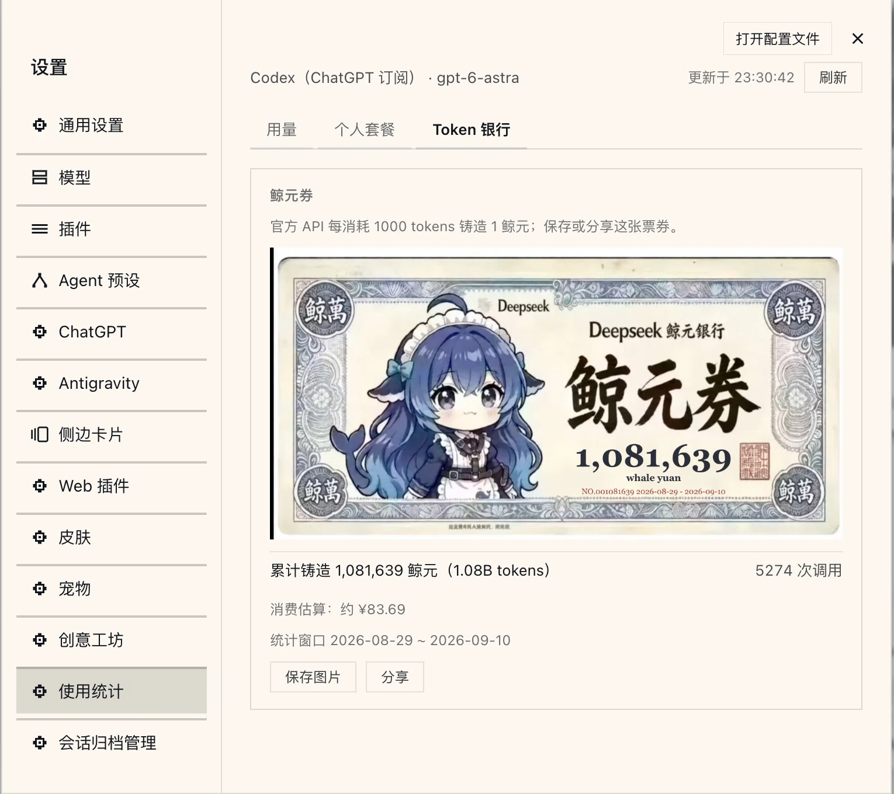
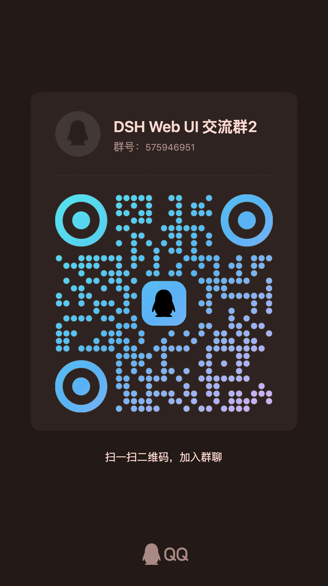

# dsh-web · Modular Plugin Ecosystem & Themes for DeepSeek Harness (DSH) Web GUI

[中文](README.md) | English

dsh-web is an all-in-one modular plugin ecosystem and AI agent workbench for DeepSeek Harness (DSH) Web GUI, DeepSeek Web UI, and the official DeepSeek Desktop client. Built for DeepSeek-V3 and DeepSeek-R1 reasoning models, it equips developers and power users with autonomous task automation boards (cron background scheduling), mobile phone app remote access, web-based SSH terminal operations and Linux cluster management, visual Git commit graphs with multi-agent worktree workspace isolation, full session search and archive management, token usage and API cost monitoring (including Token Bank), and a unified workshop for themes, skins, and desktop pets. Users can install the complete plugin bundle into an existing `dsh web` instance via the official profile mechanism, or install and run it directly in the official DeepSeek Harness desktop client.

<p align="center">
  
</p>

<p align="center">
  
  &nbsp;
  
  &nbsp;
  
  &nbsp;
  <a href="https://www.npmjs.com/package/@linxin666/dsh-web-all"></a>
  &nbsp;
  <a href="https://www.npmjs.com/package/@linxin666/dsh-web-all"></a>
  &nbsp;
  <a href="https://dshfind.com/zh/plugins/zhu1090093659/dsh-web?ref=badge"></a>
  &nbsp;
  <a href="https://dsh-market.com"></a>
  &nbsp;
  <a href="https://www.npmjs.com/package/@deepseek-ai/dsh"></a>
  &nbsp;
  
</p>

<p align="center">
  <strong>DeepSeek Harness (DSH) Web Plugin Ecosystem · Modular AI Agent Workspace</strong><br>
  <em>All-in-One Web GUI · Task Automation Board · Mobile Phone App Remote Access · Web SSH DevOps · Git Graph & Worktree · Token Cost Tracker · Themes & Skins Workshop</em>
</p>

<div align="center">

[What It Is](#what-it-is) · [Official Desktop Client](#official-desktop-client) · [Workshop](#workshop-dsh-marketcom) · [Feature Plugins](#feature-plugins) · [Skins](#skins) · [Quick Start](#quick-start) · [Compatibility](#compatibility-and-environments) · [FAQ](#faq) · [Known Limitations](#known-limitations) · [Community](#community) · [Business Cooperation](#business-cooperation)

</div>

## What It Is

Stock DeepSeek Harness Web delivers fundamental chat interactions and tool execution capabilities. However, production workflows often require concurrent task scheduling, persistent background runs, remote collaboration, and developer-oriented tooling.

dsh-web mounts directly into `dsh web` via official profiles without modifying DSH core source code, providing a comprehensive modular extension suite:
- **Developer Operations & Collaboration Plugins**: Long-running autonomous task boards (multi-agent cascade/Teams orchestration, adversarial judge verification, and cron scheduling), LiangShen Mode (minimal persona, programmatic tool transport, dispatcher discipline), mobile phone app remote access, SSH terminal operations and file transfers, Git history graphs with worktree isolation, full session archive management, and model capability declarations;
- **Decoupled Visual Themes & Assets**: Functional plugins and visual assets remain strictly separated. The skin loader handles stylesheet and dynamic effect rendering, while themes and animated desktop pets can be installed on demand from the [DSH Workshop](#workshop-dsh-marketcom);
- **Bundled or Pick-and-Choose**: Install everything with one command via `@linxin666/dsh-web-all`, or install individual plugins independently. The aggregate pre-integrates every family plugin - see the [plugin bundle installation and configuration guide](packages/dsh-web-all/README.md).


| Core Capability | Stock dsh web | dsh-web Modular Ecosystem Advantage |
| --- | --- | --- |
| Agent Presets & Disciplines | Stock presets only (Standard / Minimal, etc.), heavy context overhead | Stock presets + Workshop presets + LiangShen Mode (minimal persona, PTC program transport, gentle MCP paging, fact register, composer slot lever) |
| Custom Model Capabilities | No visual configuration for model attributes | Visual declarations for multimodal vision image inputs and DeepSeek-R1 reasoning effort tiers, with instant provider toggles |
| Autonomous Task Board | None | Host-authoritative 5-column board + multi-agent tree cascade/native Teams orchestration + double-blind judge quality gate + offline cron scheduling & sleep inhibition + GitHub Issue-to-PR automation + 8 model-callable tools |
| Mobile Phone App Remote Access | Localhost browser only | Instant QR pairing for native phone apps, protocol v1 WebSocket streaming, public relay/tunnels & LAN ingress |
| Remote Server Operations | None | Web-based SSH terminal (xterm.js), SFTP file transfer, tunnels & cluster commands |
| Token Usage & Cost Monitor | None | Daily token consumption breakdowns, multi-provider balance tracking, plan quota reset monitoring & Token Bank |
| Git Graph & Multi-Task Isolation | Terminal git commands only | Visual branch and commit graph + automated Git Worktree directories preventing concurrent agent code collisions |
| Session Search & Archive Lifecycle | Flat list accumulation | Full-text session search with multi-filter queries, batch archiving, cascade pruning & automated retention policies |
| Themes, Skins & Visuals | Single default theme | Built-in Blue Fantasy immersive dark eye-care theme, plus Wallpaper Engine live backgrounds & desktop pets on Workshop |

### Quick Index by Use Case

| User Goal & Scenario | Recommended Solution & Capability | Entry Point |
| --- | --- | --- |
| Build 24/7 autonomous background AI engineering pipelines, scheduled code audits, multi-agent team orchestration, automatic GitHub issue-to-PR resolution, or goal-driven delivery | Task Board: host background scheduling, multi-agent cascade/Teams orchestration, adversarial judge verification, automated GitHub PR workflows, and sleep inhibition | [Task board and cron execution](packages/dsh-task-board/README.md) |
| Maximize coding efficiency and minimize context waste with compact prompts, programmatic tool calling (PTC), and strict dispatcher discipline | LiangShen Mode: Minimal persona, run_code program transport, gentle MCP paging, fact register, and composer lever | [LiangShen Mode Preset & PTC](packages/dsh-liangshen/README.md) |
| Remote access and control of DeepSeek Harness from mobile phone apps via protocol v1 | Mobile App Remote Access: protocol v1 WebSocket, session streaming, ingress gateway & WAN/LAN ingress | [Mobile App Remote Access](packages/dsh-remote-bridge/README.md) |
| Delegate Linux server DevOps, SFTP file transfers, SSH terminal interactions, or incident response to AI agents | SSH Remote Ops: web terminal (xterm.js), visual SFTP transfers, port forwarding tunnels, cluster commands | [SSH terminal, file transfer, and tunnels](packages/dsh-ssh/README.md) |
| Monitor DeepSeek API and LLM token usage metrics, query provider account balances, and track subscription quotas | Usage Statistics: daily token breakdown, balance queries, bill estimation & Token Bank | [Usage statistics and Token Bank](packages/dsh-usage/README.md) |
| Multi-agent concurrent coding produces file collisions, requiring isolated Git branches and filesystem worktrees | Git Graph & Worktree: visual commit history, automatic dedicated worktree branches & directories | [Git visualization and worktree isolation](packages/dsh-git-graph/README.md) |
| Accumulated chat history is hard to search, requiring full-text multi-filter queries, batch archiving, and lifecycle pruning | Session Archive Manager: multi-filter search, batch archiving, cascade pruning & automated lifecycle policies | [Full session archive management](packages/dsh-session-archive/README.md) |
| Customize interface aesthetics with dark eye-care themes, Wallpaper Engine live backgrounds, and desktop pets | Workshop & Skin Center: built-in Blue Fantasy dark theme, plus vast skins, live wallpapers & pets | [Explore the DSH Workshop](https://dsh-market.com) |
| Use the complete plugin and theme ecosystem directly inside the official DeepSeek Harness Desktop client | Official Desktop Client: install the full aggregate bundle directly via in-app plugin manager | [Official desktop client guide](#official-desktop-client) |
| Install the all-in-one plugin bundle into an existing DeepSeek Harness CLI or Web GUI environment with one command | Quick Start: one-command installation via npm or direct GitHub repository URL | [Quick start installation](#quick-start) |

## Official Desktop Client

For a dedicated desktop application experience, we recommend downloading and using the official DeepSeek Harness desktop client (DeepSeek Harness Desktop).

The official desktop client shares the `~/.dsh` data directory with `dsh web` and operates under its internal `desktop` profile. Because the official desktop client manages the `desktop` profile exclusively within the application (external CLI commands reject modifications to the `desktop` profile), install this plugin bundle directly from inside the desktop client:

1. Open the official desktop client and navigate to the **Plugins** section in **Settings** (or the sidebar plugins view);
2. In the plugin installation input field, enter the aggregate package specifier `@linxin666/dsh-web-all` (or `@linxin666/dsh-web-all@latest`), then click **Install**;
3. Restart the desktop client once installation completes to activate all family plugins, including the task board, themes, and remote access.

## Workshop (dsh-market.com)

The [DSH Workshop](https://dsh-market.com) is a unified hub for themes, pets, plugins, and community Agent presets. Entries are ranked by verified device likes; themes provide live interactive previews, and plugins offer copy-ready install commands. The classic Blue Fantasy theme is bundled with the skin center plugin; additional themes and pets can be previewed, inspected, and installed on demand. In the Web GUI, the "Workshop" settings tab lets you browse the catalog directly: skins and pets install straight into the DSH home directory for immediate use, while community presets install to an inactive local library and activate under "Settings → Agent Presets".



The site is built directly from this repository: static pages are generated by `scripts/market-build` from authoritative manifests (`skin.json`, `pet.json`, and `community.json`), while interactive features like anonymous voting run on Cloudflare Workers edge functions with D1 persistence (one vote per device). Changes deploy automatically on push to `main`.

The Workshop provides an open, transparent space for community creators to share their work and for users to discover vetted extensions.

## Feature Plugins

### Task Board（Task Board · Enterprise Autonomous Execution Engine & Multi-Agent Pipelines）

Open from the "Task Board" icon in the sidebar. More than a visual card interface, the Task Board is the **host-authoritative background autonomous execution and multi-agent scheduling engine** for the DeepSeek Harness official Web GUI and desktop client. Tasks are tracked through a 5-column lifecycle (Backlog, Todo, In Progress, Done, Failed) backed by an atomic Schema v6 transaction ledger, delivering end-to-end automation from requirement decomposition and team orchestration to adversarial verification and external deliverables:

- **Host-Authoritative Execution & 24/7 Offline Automation**: Unlike fragile client-side boards that break when browser tabs close, all card transitions, cron triggers, and execution tracking run under the DSH Host background daemon as the single source of truth. The browser is purely an asynchronous viewport: closing tabs, locking screens, or dropping connections does not interrupt autonomous agent execution or atomic disk settlement. Built-in cross-platform sleep inhibition (macOS `caffeinate`, Windows `ES_SYSTEM_REQUIRED`, Linux `systemd-inhibit`) powers down screens while preventing host idle sleep for reliable 24/7 background operation.
- **Subtask Cascades & Native Agent Teams Orchestration**: Complex engineering goals decompose into hierarchical subtask trees (1–3 configurable depth levels with cycle detection). **Cascade Execution** triggers concurrent independent agent sessions through a rate-governed admission queue (runLaunchWidth), skipping already-settled items and aggregating tree status. **Native Agent Teams Mode** taps directly into official team services, launching a Team Lead session that dynamically spawns dedicated teammates per subtask with inter-agent tool coordination.
- **Double-Blind Adversarial Judge Verification (No False Completion)**: Solves the pervasive AI coding pitfall where agents claim success without making valid edits. When an agent invokes `update_goal(complete)`, the Host intercepts the call and dispatches an independent Judge Model (with customizable models and reasoning tiers). Verification applies strict coding criteria, a 0.65 threshold, two-round A/B position swapping, and compares the session trajectory against real filesystem workspace diffs (added/deleted lines and files). Diagnosed defects are returned for self-repair; executions failing twice are marked failed.
- **Automated GitHub Issue-to-PR Engineering Loop**: Paired with the official extension (`dsh-client-ui-task-board-github`), the board establishes real-time bidirectional synchronization with GitHub repository Issues and Pull Requests. Remote issues automatically ingest into the board, dispatching agents to diagnose bugs, patch code, and run tests. Upon verified completion, the system automatically opens a linked GitHub Pull Request and auto-closes the issue once merged, creating an autonomous 24/7 software engineering pipeline.
- **Context Continuity: Session Reuse & Freeze Handover**: Tasks can arm the native `/goal` engine for multi-round autonomous iterations, or enable session reuse to preserve active conversation context across recurring runs. Sessions can also freeze via the `<<<FREEZE` protocol into structured snapshots (goals, progress, next steps) with pinned workspace/preset/permission triplets, letting incoming agents seamlessly take over with built-in prompt injection defense and provenance audits.
- **Enterprise Permission Gates & Token Spend Limits**: Cards pin workspaces, agent presets, sandbox permissions, models, and reasoning tiers (failing closed on invalid bindings). High-risk permissions above the session baseline require manual approval via the **Permission Gate** in the Web UI before execution or cron scheduling is permitted. Configurable daily token spend limits (`spendBudgetTokens`) safeguard against runaway loops and unexpected API costs.
- **Model-Callable Agent Tool Surface & External Sync**: Exposes 8 native model tools (`task_board_list`, `task_board_get`, `task_board_create`, `task_board_update`, `task_board_set_parent`, `task_board_run`, `task_board_manage`, `task_board_schedule`), empowering conversation agents to inspect boards, split subtasks, orchestrate teams, and arm cron rules autonomously. External work completed in tools like Claude Code or Codex can also register authoritative outcomes via `record-external-outcome`.

| Multi-Column Board & Agent Collaboration | Background Scheduling & Configuration |
| --- | --- |
|  |  |

### LiangShen Mode（LiangShen Mode · Minimal Persona, PTC Runtime & Dispatcher Engine）

Toggle via the dedicated slot-machine lever in the composer on new-session screens, or select from "Settings > Agent Presets". LiangShen Mode (`dsh-liangshen`) is a killer preset and runtime engine rebuilt specifically for **maximum reasoning efficiency, minimal static context overhead, and rigorous engineering discipline**. Addressing common LLM pitfalls in complex programming — such as bloated system instructions, tool schemas flooding context windows, verbose rambling reasoning loops ("I need to..."), and degradation across long conversations — LiangShen Mode combines an action-driven minimal prompt, Programmatic Tool Calling (PTC), gentle MCP paging, and working-context fact registers to deliver an exceptionally sharp coding experience:

- **Minimal Persona & Action-Driven Working Discipline (Zero Prompt Waste)**: Strips away standard boilerplate instructions, condensing system prompts to a single-line persona and combat-tested engineering disciplines. Enforces reflection circuit-breaking (abort speculation after two reasoning passes without new evidence and immediately inspect via native tools), action orientation (thinking decides the immediate next operation rather than pre-rehearsing code), parallel exploration (dispatch multiple independent tool checks concurrently in one turn), YAGNI and PDCA cycles (validate single assumptions with zero redundant comments), and bounded convergence (converge within 2–3 inspection turns to answer or edit). This keeps the model's full attention focused strictly on your codebase.
- **Programmatic Tool Calling (PTC Transport)**: Replaces the heavyweight practice of serializing hundreds of JSON schemas on every API turn. By default, the wire collapses to a single `run_code` execution endpoint; all remaining tools are accessed programmatically via generated strongly typed SDKs running inside an isolated worker sandbox. The static transmission footprint remains microscopic regardless of tool count; models can dispatch concurrent calls via `Promise.all` and filter, slice, or aggregate large tool outputs inside the sandbox before returning concise summaries to context. For scenarios better suited to direct invocation, a one-click toggle restores the assembled Native tool roster in plugin settings.
- **Gentle Tool Paging & LRU Dynamic Activation (Gentle MCP Paging)**: Prevents dozens of connected MCP servers and extensions from overwhelming the context window. High-fan-out tool families (defaulting to `mcp__*`) remain paged out of the wire and SDK declarations on startup, presented only as compact namespace summaries. When the model needs a tool, it autonomously invokes `tool_activate({ namespace })` to mount that namespace on the fly. An LRU cache maintains up to 3 active namespaces simultaneously, automatically evicting stale ones, and safely restores state across session compactions and resumes.
- **Key Fact Register & Near-Horizon Context Projection (Fact Register)**: Prevents long-horizon context forgetting where models lose track of initial constraints or previously diagnosed failures. The preset exposes a dedicated `fact_register` tool, allowing models to record immutable requirements, confirmed architectural choices, and disproven paths as concise single-line facts (up to 160 characters each, capped at 12 entries). Recorded facts ride the `[Working Context: ...]` line projected directly above the latest user turn, ensuring persistent visibility within the local attention window.
- **Native Dispatcher Architecture & Triage Discipline (Dispatcher Identity)**: Ships with a built-in Dispatcher ruleset, enabling the agent to orchestrate complex engineering workflows like a technical lead. Features structured complexity triage (L0/L1 tasks execute directly; L2 multi-step initiatives require clarification interviews -> planning -> parallel subagent delegation -> two-tier acceptance verification); bounds interviews to a strict budget (maximum 4 questions per round, 3 rounds total, ordered by blast radius with assumption defaults); and maintains project state reliably within `todo_write`.
- **Composer Slot Lever & Jackpot Particle Effects (Interactive Lever)**: Integrates an interactive vintage slot-machine lever directly beside the model selector in the chat composer on new sessions. Pulling the lever down (via dragging, clicking, or keyboard trigger) arms LiangShen Mode with celebratory jackpot visual effects (particle burst, shockwave rings, sparks, and an Easter-egg banner); pushing it up seamlessly restores your previous default preset. The lever adapts dynamically to active skin themes and gracefully steps aside once a conversation begins.

For detailed architecture, benchmark evaluations, and configuration options, see the [dsh-liangshen README](packages/dsh-liangshen/README.md).

### Mobile Phone App Remote Access（Mobile Remote · Native Phone App Access）

After installing `@linxin666/dsh-remote-bridge` in your profile and restarting the server, click the QR code icon at the bottom of the sidebar (accessible label "Pair a phone (protocol v1)") to open the pairing panel. Scan the QR code with the mobile phone app to start using it immediately.

The pairing panel is protected by a loopback security gate on `/remote-bridge/pair/token` and can only be accessed from a browser running on localhost (remote access returns 403). Pairing codes are single-use credentials valid for 30 seconds; clicking "New code" voids the previous code. The QR code encodes a document containing the address and token (URL format `wss://<origin>/ios/v1?token=...`), allowing the mobile app to acquire both the host address and authentication token in one scan.

The network protocol surface exposes only one WebSocket endpoint at `/ios/v1`. Both tunnels and the LAN forwarder route exclusively to an ingress gate that forwards this path, keeping Web GUI routes inaccessible from the public internet. Host dial addresses resolve in order from live runtime state (relay lease or running tunnel), to the `DSH_REMOTE_PUBLIC_BASE_URL` environment variable, to the active LAN forwarding address when listening. By default, public access is available out of the box (relay is enabled by default, tunnels are off, and LAN forwarding is off); for direct local network access, enable LAN forwarding in the plugin settings. The legacy browser remote control plugin `dsh-remote-web-ui` has retired, and its ingress capabilities have migrated into this package.

### SSH Remote Ops（SSH Remote Ops · Web Terminal, SFTP Transfer & Cluster Commands）

Open the remote operations panel from the "SSH" sidebar icon. Supports key-based and password authentication, and imports existing host definitions from `~/.ssh/config` with one click; configurations persist securely in `~/.dsh/dsh-ssh.json`. Available capabilities include:

- **Web Terminal**: Full-featured interactive terminal powered by xterm.js with real-time output and responsive window resizing;
- **File Transfer**: Built-in SFTP file manager with visual upload and download progress bars and directory browsing;
- **Port Forwarding**: Local tunnels routing to remote internal services (such as databases or internal APIs), binding exclusively to 127.0.0.1;
- **Cluster Execution**: Concurrently dispatch commands across multiple servers filtered by alias, environment, or tags;
- **Agent Integration**: AI agents share host configurations with the panel; simply instruct the agent in chat to inspect remote servers and run diagnostics.

### Usage Statistics（Usage Statistics · Token Metrics, Balance Monitoring & Token Bank）

Monitor token consumption, provider balances, and subscription quotas under "Settings > Usage Statistics" with automated refresh and manual query options.

- **Usage Breakdown**: Track daily input, output, and cache token metrics segmented by provider and model, alongside 30-day expenditure trends; compatible providers display real-time balances, and DeepSeek official routes estimate off-peak pricing and billing details.
- **Subscription Tracking**: Monitor percentage allowances and reset schedules for personal plans including Kimi, GLM, MiniMax, OpenCode Go, and Codex / ChatGPT.
- **Token Bank**: Mint 1 Whale Yuan for every 1,000,000 tokens across every provider, tracked as collectible Whale Vouchers with sharing capabilities.
- **Pet Integration**: With the desktop pet plugin installed, floating desktop companions provide conversational bubble notifications displaying current quota balances and daily consumption.

Tracking starts upon initial plugin activation without backfilling historical sessions; vouchers cover every provider's tokens within configured ledger retention windows (the spend line still comes only from the observed DeepSeek official balance). See [dsh-usage README](packages/dsh-usage/README.md) for supported providers and limitations.



### Git Graph（Git Graph · Visual Commits & Worktree Session Isolation）

An integrated Git toolbar and visual commit history graph positioned above the chat composer:

- **Branch & Commit Graph**: Visualizes branch forks, merge swimlanes, and commit timelines to help developers track changes and switch branches across projects.
- **Git Worktree Isolation**: When multiple agents run concurrent tasks, modifying files in the primary checkout risks branch collisions and dirty working trees. The plugin creates isolated worktrees under `$DSH_HOME/worktrees/` on dedicated branches (`wt/<name>`), leaving primary repository files untouched. An integrated management view lets developers inspect and prune temporary checkouts.
- **Automated Policies & Agent Tooling**: Enable automatic worktree allocation for new sessions entering Git workspaces, or provide the `git_worktree` tool to autonomous agents for self-directed environment management.

| Git Graph | Parallel Sessions with Git Worktree |
| --- | --- |
|  |  |

### Session Archive Manager（Session Archive · Full-Text Search, Batch Archiving & Lifecycle）

The session archive manager (`dsh-session-archive`) provides centralized governance over growing numbers of short-lived and persistent conversation logs:

- **Centralized Search & Filtering**: Audit active, archived, blank, subagent, and orphaned historical sessions with keyword filtering across titles, workspaces, and session IDs.
- **Batch Actions with Cascade Safety**: Perform multi-select archiving, restoration, and permanent deletions. Physical deletions display affected descendant counts and estimated reclaimed disk space, requiring confirmation prompts for bulk actions; active sessions and sessions with running children remain protected against deletion.
- **Automated Retention Policies**: Two optional automated rules archive stale sessions based on last activity and prune aged archives by retention period, with dry-run previews supported before enabling.

Permanent deletions cannot be undone, and all operational routes bind strictly to the local loopback interface. See [dsh-session-archive README](packages/dsh-session-archive/README.md).

### More Plugins（更多插件）

- **Skill Explorer** (`dsh-client-ui-skill-explorer`): Inspect and manage loaded agent skills grouped by origin, featuring keyword filtering across names and descriptions, workspace scoping, and activation toggling.
- **Plugin Manager** (`dsh-client-ui-plugin-manager`): Install plugins from npm or git repositories via official host interfaces, inspect statuses, and adjust configuration settings.
- **Plugin Self-Update** (`dsh-update`): Automatically detects new releases on npm and provides release notes with one-click in-place upgrades right from the sidebar footer.
- **Task Board GitHub Sync** (`dsh-client-ui-task-board-github`): Seamlessly connects GitHub Issues with task board cards, enabling autonomous AI Agent bug triage and automated PR delivery.
- **Session ID Helper** (`dsh-client-ui-session-id`): Quick sidebar-footer access to copy full session IDs and search across active/archived sessions with zero host overhead.
- **Internationalization Pack** (`dsh-i18n`): Registers Russian (Русский) localization and centrally carries multilingual dictionaries for all family plugin namespaces.

### Skins

The classic Blue Fantasy theme serves as the built-in default skin: rich indigo gradients, semi-transparent frosted glass elements, and custom whale artwork provide an immersive dark-mode visual experience. Additional themes and Wallpaper Engine animated backgrounds are managed by the skin center and can be previewed, tried on, and installed through the [Workshop](https://dsh-market.com).


## Quick Start

### System Requirements

- DeepSeek Harness installed with `dsh web` functioning properly.
- npm installations have no extra requirements; building from the source repository requires Node.js >= 22 and pnpm.

### Get Started in 3 Steps (npm, Recommended)

- **DSH Web CLI (Browser Installation)**:
  1. Approve the three build scripts first (see Install Troubleshooting), then run `dsh plugin --profile web add @linxin666/dsh-web-all@latest`
  2. Restart `dsh web` to display new plugin icons in the sidebar
  3. Navigate to "Settings > Plugin Configuration" to toggle individual features, or select skins from the skin panel
- **Official Desktop Client (DeepSeek Harness Desktop)**:
  1. Open the official desktop client and navigate to "Settings > Plugins"
  2. Enter `@linxin666/dsh-web-all` in the plugin install input and click Install
  3. Restart the client to access all plugin features and settings from the sidebar

> To install only the skin engine, use `@linxin666/dsh-client-ui-skin-center`. If your package manager pins an older version due to release age restrictions, see "Install Troubleshooting" below.

### Install Directly from the GitHub Repository

The repository root includes a standard `dsh.bundle` manifest, allowing installation directly from git without cloning or manual building:

```sh
dsh plugin --profile web add github:zhu1090093659/dsh-web
# Equivalent: dsh plugin --profile web add git+https://github.com/zhu1090093659/dsh-web.git
```

This approach is equivalent to installing the npm aggregate package. Use either method, but do not install both simultaneously to prevent conflicting entry IDs.

### Install from the Repository (Development)

For plugin development and debugging, build from source using Node.js >= 22 and pnpm:

```sh
# 1. Clone the repository
git clone https://github.com/zhu1090093659/dsh-web.git
cd dsh-web

# 2. Install dependencies and build all packages
pnpm install
pnpm -r build

# 3. Link packages into the web profile (linking sub-packages before the aggregate is recommended)
node scripts/link-profile.mjs
dsh plugin --profile web add link:$(pwd)/packages/dsh-web-all

# 4. Restart the web server
dsh web
```

> Note: Because profile directories are not configured as pnpm workspaces, internal `workspace:*` dependencies fall back to npm versions. If published npm packages differ from local builds, run `node scripts/link-profile.mjs` first to ensure all sub-packages resolve to local build outputs.

### Install a Single Plugin

Install individual components independently if you prefer not to use the complete bundle:

```sh
dsh plugin --profile web add @linxin666/dsh-client-ui-task-board@latest              # Task Board
dsh plugin --profile web add @linxin666/dsh-liangshen@latest                       # LiangShen Mode (Minimal Preset & PTC)
dsh plugin --profile web add @linxin666/dsh-client-ui-task-board-github@latest      # Task board GitHub Issues sync extension
dsh plugin --profile web add @linxin666/dsh-ssh@latest                             # SSH Remote Ops
dsh plugin --profile web add @linxin666/dsh-usage@latest                           # Usage Statistics
dsh plugin --profile web add @linxin666/dsh-pet@latest                             # Desktop Pet
dsh plugin --profile web add @linxin666/dsh-session-archive@latest                 # Session Archive Manager
dsh plugin --profile web add @linxin666/dsh-update@latest                          # Plugin Self-Update
dsh plugin --profile web add @linxin666/dsh-client-ui-session-id@latest            # Session ID Helper
dsh plugin --profile web add @linxin666/dsh-client-ui-skill-explorer@latest        # Skill Explorer
dsh plugin --profile web add @linxin666/dsh-i18n@latest                            # Internationalization Pack
```

<details>
<summary><strong>Full npm Package Directory</strong></summary>

All plugins are published under the `@linxin666/dsh-*` npm scope:

| Package Name | Description |
| --- | --- |
| [@linxin666/dsh-web-all](https://www.npmjs.com/package/@linxin666/dsh-web-all) | Aggregate bundle: complete suite of feature plugins and skin center |
| [@linxin666/dsh-client-ui-task-board](https://www.npmjs.com/package/@linxin666/dsh-client-ui-task-board) | Task board: host-authoritative autonomous execution, multi-agent cascade/Teams orchestration, judge verification & cron scheduling |
| [@linxin666/dsh-client-ui-task-board-github](https://www.npmjs.com/package/@linxin666/dsh-client-ui-task-board-github) | Task board extension: GitHub Issues sync, on by default and switchable off in settings |
| [@linxin666/dsh-liangshen](https://www.npmjs.com/package/@linxin666/dsh-liangshen) | LiangShen Mode: Minimal system prompt, PTC tool dispatch, MCP paging, and dispatcher discipline |
| [@linxin666/dsh-remote-bridge](https://www.npmjs.com/package/@linxin666/dsh-remote-bridge) | Mobile app remote access: protocol v1 host adaptor, native client WebSocket, ingress gate & WAN/LAN ingress |
| [@linxin666/dsh-ssh](https://www.npmjs.com/package/@linxin666/dsh-ssh) | SSH operations: web terminal, SFTP transfers, tunnels, and cluster commands |
| [@linxin666/dsh-usage](https://www.npmjs.com/package/@linxin666/dsh-usage) | Usage statistics: token consumption, balances, plan tracking, and Token Bank |
| [@linxin666/dsh-pet](https://www.npmjs.com/package/@linxin666/dsh-pet) | Desktop pet: registry-driven interactive floating companions |
| [@linxin666/dsh-client-ui-git-graph](https://www.npmjs.com/package/@linxin666/dsh-client-ui-git-graph) | Git graph: visual commit logs, branch flows, and worktree isolation |
| [@linxin666/dsh-client-ui-skin-center](https://www.npmjs.com/package/@linxin666/dsh-client-ui-skin-center) | Skin center: runtime engine for themes and dynamic backgrounds |
| [@linxin666/dsh-client-ui-market](https://www.npmjs.com/package/@linxin666/dsh-client-ui-market) | Workshop client: one-click installation for skins, pets, and presets |
| [@linxin666/dsh-client-ui-preset-center](https://www.npmjs.com/package/@linxin666/dsh-client-ui-preset-center) | Preset center: community Agent preset repository management |
| [@linxin666/dsh-client-ui-plugin-manager](https://www.npmjs.com/package/@linxin666/dsh-client-ui-plugin-manager) | Plugin manager: install, toggle, and configure extensions |
| [@linxin666/dsh-client-ui-skill-explorer](https://www.npmjs.com/package/@linxin666/dsh-client-ui-skill-explorer) | Skill explorer: browse, search, and manage registered agent skills |
| [@linxin666/dsh-session-archive](https://www.npmjs.com/package/@linxin666/dsh-session-archive) | Session archive: search, batch restore, and cascade pruning |
| [@linxin666/dsh-client-ui-community-plugins](https://www.npmjs.com/package/@linxin666/dsh-client-ui-community-plugins) | Community plugin source: authoritative index powering the Workshop |
| [@linxin666/dsh-client-ui-web-ui-settings](https://www.npmjs.com/package/@linxin666/dsh-client-ui-web-ui-settings) | Preferences panel: global settings and UI configurations |
| [@linxin666/dsh-update](https://www.npmjs.com/package/@linxin666/dsh-update) | Plugin Self-Update: Release detection, changelog panel, and one-click in-place upgrades |
| [@linxin666/dsh-client-ui-session-id](https://www.npmjs.com/package/@linxin666/dsh-client-ui-session-id) | Session ID Helper: Sidebar panel for quick full session ID viewing and copy |
| [@linxin666/dsh-i18n](https://www.npmjs.com/package/@linxin666/dsh-i18n) | Internationalization Pack: Russian localization and multilingual dictionary provider |

</details>

### Verify and Uninstall

Restart `dsh web` after installation; the appearance of corresponding sidebar icons indicates successful mounting. Run `dsh --profile web --dump-config` to confirm the configuration layer is loaded. If icons do not appear, verify that the service process has fully restarted.

To uninstall: run `dsh plugin --profile web remove @linxin666/dsh-web-all` and restart `dsh web`.

Architecture and mounting details are documented in [docs/plugins.md](docs/plugins.md).

### Install Troubleshooting

<details>
<summary><strong>Common Installation and Build Resolutions</strong></summary>

<br>

> **Missing Sub-package Errors under Isolated pnpm**: In strict isolated mode, pnpm may hoist only the aggregate package while placing sub-packages in nested directories, causing errors like `Cannot find package '@linxin666/dsh-...'`. Add `nodeLinker: hoisted` (or `public-hoist-pattern: ['@linxin666/*']`) to your profile's `pnpm-workspace.yaml` and reinstall.

> **Blocked Build Scripts (ERR_PNPM_IGNORED_BUILDS)**: approve `cloudflared`, `cpu-features`, `ssh2` before the first add: reset the profile (`--from-default-profile web`) or use a fresh one, put them under `allowBuilds` in `<profile>/pnpm-workspace.yaml`, then add. Approving later and re-running exits 0 but adds no `dsh.profile.bundles` row - a silent half-mount re-runs cannot repair. Existing approved profiles upgrade unaffected.

> **pnpm 11 Release Age Restrictions**: For newly published versions, pnpm 11's default security window (`minimumReleaseAge`) may pull older package revisions. Exclude the namespace in `pnpm-workspace.yaml` to ensure timely updates:
>
> ```yaml
> minimumReleaseAgeExclude:
>   - '@linxin666/*'
> ```

</details>

## Compatibility and Environments

dsh-web is engineered for seamless operation across diverse operating systems, client browsers, and network topologies:

| Dimension | Supported Matrix & Specifications |
| --- | --- |
| Host Runtime | DeepSeek Harness CLI (`dsh web`), Official Desktop Client (DeepSeek Harness Desktop) |
| Operating Systems | macOS (Apple Silicon M-series & Intel), Windows 10/11 (including WSL2), Linux (Ubuntu, Debian, Fedora, Arch, CentOS, etc.) |
| Browsers & Devices | Desktop Chrome, Edge, Safari, Firefox; Mobile iOS Safari, Android Chrome, and modern mobile browsers |
| Network Topologies | Localhost (127.0.0.1), Local Area Network (LAN), Secure WAN Tunnels (Cloudflare Tunnel, Tailscale, FRP, Nginx reverse proxies) |
| LLM Provider Matrix | DeepSeek official routes & reasoning models, OpenAI, Anthropic Claude, Google Gemini, Kimi, GLM, MiniMax, Ollama local models, SiliconFlow, etc. |
| Runtime Prerequisites | npm installation requires no extra developer tools; building from source requires Node.js >= 22 and pnpm >= 9 |

## FAQ

<details>
<summary><strong>Why do sidebar icons not show up after restarting?</strong></summary>

Verify that the package was added with the `--profile web` parameter and run `dsh --profile web --dump-config` to inspect active configuration layers. Simply refreshing the web browser is insufficient; the backend `dsh web` process must be fully restarted.

</details>

<details>
<summary><strong>Why did a scheduled task miss its execution window?</strong></summary>

Scheduling runs directly on the `dsh web` host daemon without requiring browser tabs to stay open. If the host process exits or the system enters sleep, missed triggers are skipped rather than backfilled; overlapping runs will defer to the next matching interval. Enable task board power protection to keep the machine awake during unattended schedules.

</details>

<details>
<summary><strong>Why does mobile pairing fail to stream real-time updates?</strong></summary>

The mobile app communicates with the host through the protocol v1 WebSocket channel. During tunnel or relay disruptions, streaming updates pause and will automatically reconnect once the network recovers; pacing differences are primarily caused by wide-area round-trip latency.

</details>

<details>
<summary><strong>How do I revert a theme preview?</strong></summary>

The skin center includes zero-disk previewing: preview changes apply instantly in memory and revert upon closing the preview panel. Themes persist to disk only when you click "Apply".

</details>

<details>
<summary><strong>Can I install only the themes or a single plugin?</strong></summary>

Yes. Install `@linxin666/dsh-client-ui-skin-center` for themes alone, or install any single package using the package names in the "Install a Single Plugin" section.

</details>

<details>
<summary><strong>Can individual plugins be installed alongside the aggregate bundle?</strong></summary>

Yes. Aggregate bundle entries use the `web-ui-` ID prefix (such as `web-ui-usage`), avoiding duplicate loader ID collisions with standalone packages. The host automatically deduplicates instances. Generally, the aggregate package alone fulfills all needs.

</details>


<details>
<summary><strong>How do I access DeepSeek Harness from a mobile phone app? Does it require the same local network?</strong></summary>

Mobile remote access is powered by protocol v1 and does not require sharing the same Wi-Fi network. By default, the plugin enables public relay access; click the QR code icon at the bottom of the desktop sidebar to open the pairing panel, then scan the QR code with the mobile phone app to connect over the internet. Cloudflare Tunnels can also be configured. To connect directly over a local network, enable LAN forwarding in the plugin settings before scanning the QR code.

</details>

<details>
<summary><strong>Will scheduled tasks continue to execute after closing the browser or when the computer enters sleep mode?</strong></summary>

Task scheduling runs directly within the `dsh web` host daemon on the server machine, so closing browser tabs will not interrupt pending or running tasks. However, if the machine enters deep sleep or is powered down, the host process pauses and missed scheduled triggers will follow the skip policy rather than backfilling. To ensure unattended 24/7 background execution, enable the optional "Power Management" setting in the Task Board configuration to keep the system awake while allowing screens to power off.

</details>

<details>
<summary><strong>How can I monitor token consumption and check account balances across different LLM providers?</strong></summary>

With the Usage Statistics plugin installed, open "Settings > Usage Statistics" to view daily breakdowns of input, output, and cached tokens, alongside 30-day expenditure trends per model. When using DeepSeek official endpoints, the panel provides off-peak pricing and billing estimates; for compatible third-party providers, the plugin periodically queries remaining account balances and plan reset intervals.

</details>

<details>
<summary><strong>How do I prevent Git merge conflicts and file overwrites when multiple AI agents work concurrently?</strong></summary>

Running multiple autonomous agents in a single shared Git checkout often results in overwritten files and dirty working trees. With the built-in Git Graph plugin, you can automatically or manually allocate dedicated Git Worktrees for each session. Every agent operates on its own isolated branch and filesystem directory under `$DSH_HOME/worktrees/`, completely protecting the main working tree until you are ready to review and merge changes.

</details>

## Known Limitations

- Task board scheduling runs on the backend host; closing browser tabs will not interrupt tasks, but stopping the host process or putting the machine to sleep will skip missed schedules without backfilling. Optional power management prevents idle sleep only and cannot bypass manual sleep, lid closure, or power shutdown (see [dsh-task-board README](packages/dsh-task-board/README.md)).
- SSH credentials (passwords and private key passphrases) persist locally in `~/.dsh/dsh-ssh.json` with 0600 permissions; reconnecting during connection drops may replay non-idempotent commands, and remote outputs return without sanitization (see [dsh-ssh README](packages/dsh-ssh/README.md)).
- Mobile app streaming is relayed through a tunnel or the stable-hostname relay, adding wide-area round-trip latency to each update; the relay costs one hop more than a bare quick tunnel, and both are available.
- Full repository builds require Node.js >= 22 and pnpm; standard npm installations have no developer tool prerequisites.

## Community

Join the community to discuss workflows, report issues, and share ideas.

Scan the QR code to join the "DSH Web" QQ community:



You can also join our [Discord community](https://discord.gg/6v4gm9u4S), or submit bug reports and feature requests directly via [GitHub Issues](https://github.com/zhu1090093659/dsh-web/issues).


### Keywords and Topics Index

`DeepSeek` · `DeepSeek Harness` · `DSH` · `DeepSeek Web` · `DeepSeek Web UI` · `DeepSeek Web GUI` · `DeepSeek Desktop Client` · `DeepSeek Desktop` · `DeepSeek-V3` · `DeepSeek-R1` · `DeepSeek Plugins` · `DeepSeek Extensions` · `DeepSeek Task Board` · `DeepSeek Cron Scheduling` · `DeepSeek Autonomous Automation` · `DeepSeek Mobile Remote` · `DeepSeek Phone Access` · `DeepSeek Mobile App` · `DeepSeek SSH Terminal` · `DeepSeek Server DevOps` · `DeepSeek Token Tracker` · `DeepSeek API Cost Monitor` · `Token Bank` · `DeepSeek Themes` · `DeepSeek Skins` · `DeepSeek Live Wallpapers` · `Wallpaper Engine` · `DeepSeek Desktop Pet` · `DeepSeek Git Graph` · `DeepSeek Worktree Isolation` · `DeepSeek Session Archive` · `Multi-Agent Collaboration` · `AI Agent Workspace` · `AI Coding Assistant` · `Open Source AI Agent`

### Friendly Links

- [LINUX DO](https://linux.do) —— An earnest community for modern developers.
- [dshfind](https://dshfind.com) —— Learning and discovery hub for DSH: paper deep-dives, plugin directory, and community leaderboards.

## Business Cooperation

We welcome ecosystem integrations, custom development, and commercial collaborations. For business inquiries, please reach out via email: [chunlinzhu666@gmail.com](mailto:chunlinzhu666@gmail.com).

## Contributing

- Review [CONTRIBUTING.md](CONTRIBUTING.md) before opening a pull request; attach screenshots or evidence for user-facing modifications;
- Follow Conventional Commits (such as `fix(task-board): resolve state sync issue`); emoji usage is prohibited across code, documentation, and commit messages;
- Scaffold new plugins with `node scripts/dsh-plugin-new <name>`; new skins are scaffolded in the [dsh-skins](https://github.com/zhu1090093659/dsh-skins) repository with `node scripts/dsh-skin-new.cjs <id>`;
- Verify repository quality gates before submitting: `pnpm typecheck && pnpm test && pnpm docs:check`; complete development workflow in [docs/development.md](docs/development.md).

## License

Licensed under [Apache-2.0](LICENSE). Imported third-party code must retain original licenses and attributions; active third-party dependencies should be integrated via npm packages or forks rather than code copying.

### Sources & Licensing

<details>
<summary>Third-party sources & licenses (click to expand · plugins / skins / pets)</summary>

**Plugins**

- **dsh-task-board / dsh-task-board-github / dsh-git-graph / dsh-pet / dsh-remote-bridge / dsh-remote-web-ui / dsh-web-settings / dsh-ssh / dsh-skill-explorer / dsh-market / dsh-plugin-manager / dsh-community-plugins / dsh-web-all / dsh-liangshen / dsh-update / dsh-session-id / dsh-usage / dsh-session-archive / dsh-i18n** — authored by zhu1090093659, Apache-2.0 (zhu1090093659)
- **dsh-ssh** — implemented against the capability list of [badseal/ssh-skill](https://github.com/badseal/ssh-skill); code is this repository's Apache-2.0 (zhu1090093659), the upstream capability list belongs to badseal/ssh-skill
- **Community plugin index** — 130+ external plugins with sources and licenses declared by their authors, registered in [community.json](https://github.com/zhu1090093659/dsh-community-plugins/blob/main/community.json), browsable in Settings → Community Plugins and on dsh-market.com

**Skins (third-party authors or artwork)**

- **maid-atelier / orca-link** — [Small-tailqwq/dsh-deep-whale](https://github.com/Small-tailqwq/dsh-deep-whale), CC BY-NC-SA 4.0; attribution chains in the in-package LICENSE/NOTICE (maid: 上善 → zipzip → Small-tailqwq; orca: 上善 → Small-tailqwq)
- **phoebe-atelier** — [Theater-ahyeon/phoebe-atelier](https://github.com/Theater-ahyeon/phoebe-atelier), CC BY-NC-SA 4.0; the character Phoebe is (c) Kuro Games (Wuthering Waves); AI-assisted fan derivative, non-commercial use only (attribution chain in the package LICENSE/NOTICE)
- **cyber-night** — logan0116; code under the repository license, backdrop generated by the author with OpenAI GPT and released as CC0 1.0 (public domain)
- **future-window** — zhuqin; original background and decorative artwork Apache-2.0 (in-package LICENSE/NOTICE, attribution in skin.json)
- **matrix** — contributor seanchen original (Matrix dark eye-care skin), Apache-2.0 (declared by seanchen)
- **blue-fantasy** — powerdog996 (DreamSkin community) adapted by dsh-web; no third-party license statement in the skin directory (pending author confirmation)
- **whalechan-harness** — Whale-chan Theme contributors from [online111111/whalechan-dsh-theme](https://github.com/online111111/whalechan-dsh-theme); character direction references [Neko3000/deepseek-whalechan](https://github.com/Neko3000/deepseek-whalechan), CC BY-NC-SA 4.0, with full attribution and unofficial-project disclaimer in the skin directory LICENSE/NOTICE
- **deep-current** — Twelveeee; no license statement in the skin directory (pending author confirmation)
- **furina** — artwork by sclass53, skin code zhu1090093659 (in-directory LICENSE is BSD-3-Clause); the Furina character belongs to miHoYo (Genshin Impact) and is used as fan art
- **harbor** — moeblack; no license statement in the skin directory (pending author confirmation)
- **miku** — artwork by 涂山苏苏, skin code zhu1090093659; the Hatsune Miku character belongs to Crypton Future Media, INC. (Piapro Character License)
- **pink-sakura** — artwork by guomengjia618-dot, skin code zhu1090093659 (in-directory LICENSE is Apache-2.0)
- **war-thunder** — skin code is this repository's (Apache-2.0); the background art and launcher crest are extracted read-only from a local War Thunder client, copyright Gaijin Entertainment, personal non-commercial use only (see skin.json attribution)
- **blue-throated-bee-eater** — skin code is this repository's (dsh-web, Apache-2.0); background photo by Kriangsak Hongchumpae (Wikimedia Commons, CC BY-SA 4.0, downscaled and re-compressed; the license and attribution chain are in the in-directory NOTICE and skin.json attribution)
- **whale-maid (Whale Girl · Sea Gaze)** — the skin engineering, both backdrop illustrations and the decorative SVG assets are original work by stushansusu, released under CC BY-NC-SA 4.0 (in-directory LICENSE, attribution in skin.json)

> The remaining skins (mint / whale-song / whale-mom / dragon-heir / minecraft / trading / summer-liquid-glass / wallpaper-exclusive / xp) are original to this repository, Apache-2.0.

**Pets**

- **ouo-neko** — Pessimist0906, MIT (contribution record in [PR #1118](https://github.com/zhu1090093659/dsh-web/pull/1118) and dsh-pet [THIRD_PARTY_NOTICES.md](https://github.com/zhu1090093659/dsh-pet/blob/main/THIRD_PARTY_NOTICES.md))
- **whale / whale-refined** — whale ornaments derived from the DeepSeek wordmark (MIT / BSD-3-Clause; materials and statements in dsh-pet THIRD_PARTY_NOTICES.md)
- **miku** — artwork by stushansusu (涂山苏苏), MIT; the "Hatsune Miku" name, likeness and portrait rights belong to Crypton Future Media, INC. (Piapro Character License)
- **jyn (女仆鲸鱼娘)** — 11726, MIT (contribution record in [PR #1362](https://github.com/zhu1090093659/dsh-web/pull/1362))
- **doro (朵拉)** — stushansusu, MIT (contribution record in [PR #1630](https://github.com/zhu1090093659/dsh-web/pull/1630)); the "doro" character is an unofficial fan-made meme derivative of Dorothy from *Goddess of Victory: Nikke* — the character and all related rights belong to SHIFT UP, the assets are personal non-commercial use only, and this is not affiliated with the official work (see [THIRD_PARTY_NOTICES.md](https://github.com/zhu1090093659/dsh-pet/blob/main/THIRD_PARTY_NOTICES.md))
- **blue-throated-bee-eater (蓝喉蜂虎)** — original to this repository (dsh-web, Apache-2.0; contribution record in [PR #1402](https://github.com/zhu1090093659/dsh-web/pull/1402))
- **starry-doll (星夜人偶)** — Theater-ahyeon, CC BY-NC-SA 4.0 (non-commercial use only)

</details>

## Contributors

<!-- CONTRIBUTORS:START -->
<p align="center">
  <a href="https://github.com/zhu1090093659"></a>
  <a href="https://github.com/Aa728848"></a>
  <a href="https://github.com/stushansusu"></a>
  <a href="https://github.com/thinkmoon"></a>
  <a href="https://github.com/sharkymew"></a>
  <a href="https://github.com/Nwflower"></a>
  <a href="https://github.com/Theater-ahyeon"></a>
  <a href="https://github.com/mkloveyy"></a>
  <a href="https://github.com/Nath-Vikky"></a>
  <a href="https://github.com/yezi4271"></a>
  <a href="https://github.com/whitelonng"></a>
  <a href="https://github.com/guomengjia618-dot"></a>
  <a href="https://github.com/Qiuner"></a>
  <a href="https://github.com/SnowNightt"></a>
  <a href="https://github.com/suharvest"></a>
  <a href="https://github.com/ch1bug"></a>
  <a href="https://github.com/chemmy-11"></a>
  <a href="https://github.com/4evercool"></a>
  <a href="https://github.com/Menghuan1918"></a>
  <a href="https://github.com/wingsky-1"></a>
  <a href="https://github.com/JiewiW"></a>
  <a href="https://github.com/Qinling-Melon-Farmers"></a>
  <a href="https://github.com/PerryLink"></a>
  <a href="https://github.com/isdoge"></a>
  <a href="https://github.com/Xeehho"></a>
  <a href="https://github.com/EricWang1358"></a>
  <a href="https://github.com/skymecode"></a>
  <a href="https://github.com/GreenLv"></a>
  <a href="https://github.com/oh-wang"></a>
  <a href="https://github.com/TiankunDai"></a>
  <a href="https://github.com/Small-tailqwq"></a>
  <a href="https://github.com/Grivn"></a>
  <a href="https://github.com/ads4395-prog"></a>
  <a href="https://github.com/matriox1003"></a>
  <a href="https://github.com/spacexun2"></a>
  <a href="https://github.com/xiaoyuyu6420"></a>
  <a href="https://github.com/z953218350"></a>
  <a href="https://github.com/taekchef"></a>
  <a href="https://github.com/LittleDarkZero"></a>
  <a href="https://github.com/guo6x"></a>
  <a href="https://github.com/YEYUbaka"></a>
  <a href="https://github.com/web-flow"></a>
  <a href="https://github.com/DDDMUC"></a>
  <a href="https://github.com/Abyss-Seeker"></a>
  <a href="https://github.com/JsonFish"></a>
  <a href="https://github.com/dickpy"></a>
  <a href="https://github.com/suyicon"></a>
  <a href="https://github.com/xohmai"></a>
  <a href="https://github.com/online111111"></a>
  <a href="https://github.com/BlessedWithLuck1105"></a>
  <a href="https://github.com/RevolutionLA"></a>
  <a href="https://github.com/Noob-stupid"></a>
  <a href="https://github.com/Zacklinkk"></a>
  <a href="https://github.com/weike-zhang"></a>
  <a href="https://github.com/Richard-Peng402"></a>
  <a href="https://github.com/liiydong"></a>
  <a href="https://github.com/logan0116"></a>
  <a href="https://github.com/nicecx"></a>
  <a href="https://github.com/nickkkkkk123123"></a>
  <a href="https://github.com/lpreterite"></a>
  <a href="https://github.com/Jamsharden"></a>
  <a href="https://github.com/neystan"></a>
  <a href="https://github.com/qzhqzh"></a>
  <a href="https://github.com/rainow"></a>
  <a href="https://github.com/rongxingda"></a>
  <a href="https://github.com/lemonmmice"></a>
  <a href="https://github.com/kyrie204"></a>
  <a href="https://github.com/kop022"></a>
  <a href="https://github.com/wang-kaopu"></a>
  <a href="https://github.com/dongwenxiu83-web"></a>
  <a href="https://github.com/heyizhiyuan"></a>
  <a href="https://github.com/ma15803216102"></a>
  <a href="https://github.com/Chimney"></a>
  <a href="https://github.com/viplocco"></a>
  <a href="https://github.com/activeing123"></a>
  <a href="https://github.com/JAVA-LW"></a>
  <a href="https://github.com/AngleNaris"></a>
  <a href="https://github.com/ShiroEirin"></a>
  <a href="https://github.com/zxkk97984-creator"></a>
  <a href="https://github.com/yiyueawa"></a>
  <a href="https://github.com/wertyq111"></a>
  <a href="https://github.com/zbsph"></a>
  <a href="https://github.com/yufengnigel"></a>
  <a href="https://github.com/yongshuai0314"></a>
  <a href="https://github.com/yindf"></a>
  <a href="https://github.com/xiaobin"></a>
  <a href="https://github.com/wszhoho"></a>
  <a href="https://github.com/wsy222"></a>
  <a href="https://github.com/wig123"></a>
  <a href="https://github.com/v833"></a>
  <a href="https://github.com/user-A100"></a>
  <a href="https://github.com/tr1v3r"></a>
  <a href="https://github.com/starryrbs"></a>
  <a href="https://github.com/SnowCrescenter-tech"></a>
  <a href="https://github.com/slywalker2006"></a>
  <a href="https://github.com/Sivan757"></a>
  <a href="https://github.com/sclass53"></a>
  <a href="https://github.com/QIU0826"></a>
  <a href="https://github.com/PcHeN0720"></a>
  <a href="https://github.com/OctKwong30"></a>
  <a href="https://github.com/Moeblack"></a>
  <a href="https://github.com/Lem0nTea2002"></a>
  <a href="https://github.com/LHMQ878"></a>
  <a href="https://github.com/jcaiagent7143-ui"></a>
  <a href="https://github.com/JUANWANG-BUAA"></a>
  <a href="https://github.com/Izgenlre"></a>
  <a href="https://github.com/NuCl34R"></a>
  <a href="https://github.com/HAN102300"></a>
  <a href="https://github.com/superman32432432"></a>
  <a href="https://github.com/FoolishWiser"></a>
  <a href="https://github.com/farobute"></a>
  <a href="https://github.com/DavidWanm"></a>
  <a href="https://github.com/DamonKoy"></a>
  <a href="https://github.com/aexachao"></a>
  <a href="https://github.com/ch3n4y"></a>
  <a href="https://github.com/Beverly621"></a>
  <a href="https://github.com/AmethystLuna"></a>
  <a href="https://github.com/AlfredChaos"></a>
  <a href="https://github.com/Aik358"></a>
  <a href="https://github.com/Zhiyi-Zhao"></a>
  <a href="https://github.com/liaoyonghong"></a>
  <a href="https://github.com/YeqingTang"></a>
  <a href="https://github.com/cncolder"></a>
  <a href="https://github.com/great-man2096"></a>
  <a href="https://github.com/Starfie1d1272"></a>
  <a href="https://github.com/WyxBUPT-22"></a>
  <a href="https://github.com/Wike-CHI"></a>
  <a href="https://github.com/CCMKCCMK"></a>
  <a href="https://github.com/wanpan11"></a>
  <a href="https://github.com/Walvez"></a>
  <a href="https://github.com/Volta-ln"></a>
  <a href="https://github.com/UnusWhite"></a>
  <a href="https://github.com/Ultroncn"></a>
  <a href="https://github.com/Twelveeee"></a>
  <a href="https://github.com/Tinger-X"></a>
  <a href="https://github.com/mrSutivu"></a>
  <a href="https://github.com/Signalight"></a>
  <a href="https://github.com/Scotlight"></a>
  <a href="https://github.com/NikolaFC"></a>
  <a href="https://github.com/RINGOLINK"></a>
</p>
<p align="center">
  <sub><a href="https://github.com/zhu1090093659/dsh-web/graphs/contributors">View all contributors</a></sub>
</p>
<!-- CONTRIBUTORS:END -->

<div align="center">

**If you like it, give us a star.**

[Report Bug](https://github.com/zhu1090093659/dsh-web/issues) · [Request Feature](https://github.com/zhu1090093659/dsh-web/issues) · [View Releases](https://github.com/zhu1090093659/dsh-web/releases)

</div>