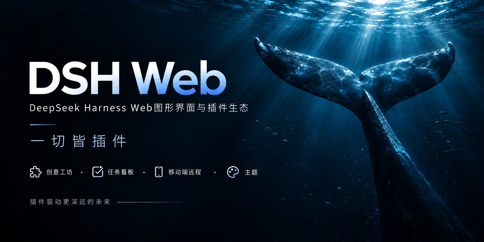
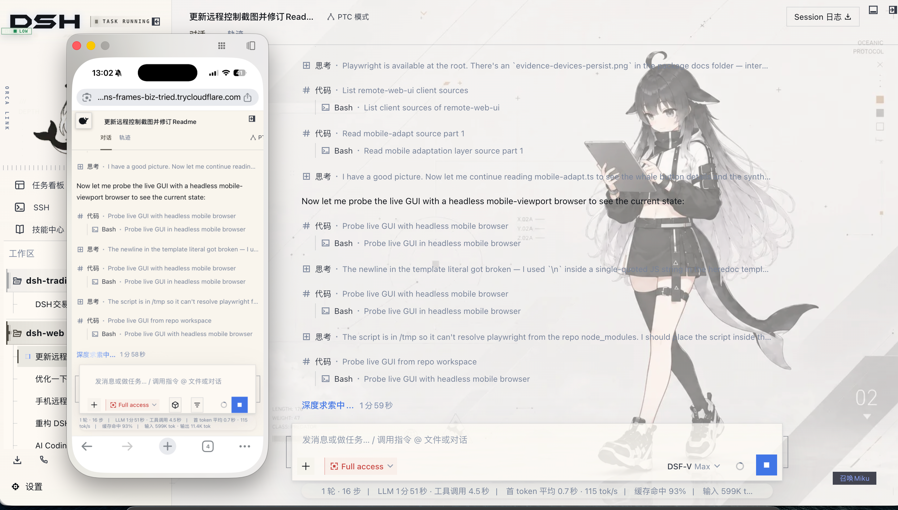
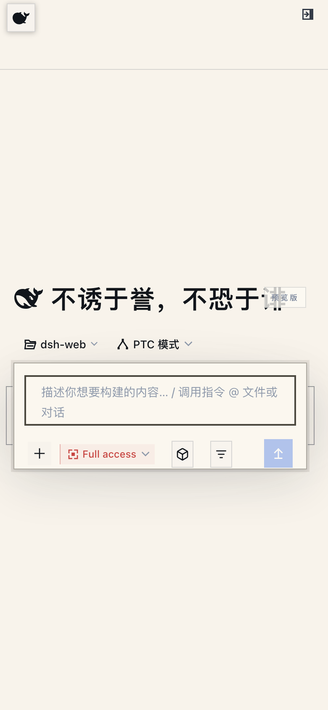
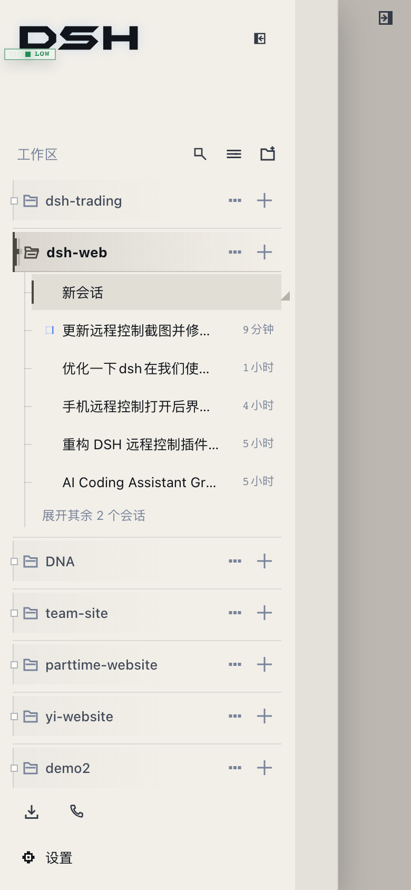
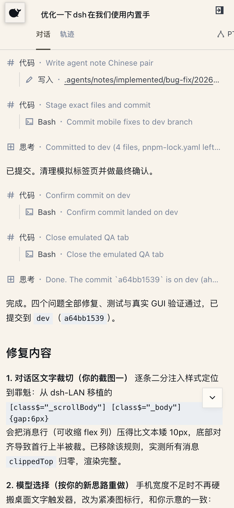
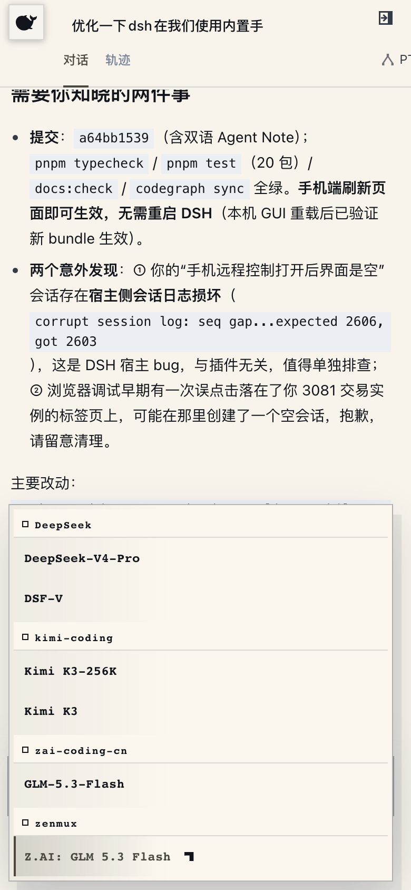

# dsh-web · DeepSeek Harness (DSH) Web GUI 插件与主题全家桶

中文 | [English](README.en.md)

dsh-web 是面向 DeepSeek Harness（DSH）Web GUI、DeepSeek 网页版与官方桌面客户端（DeepSeek Desktop）的模块化插件生态与 AI 智能体开发工作台。全面支持 DeepSeek-V3 与 DeepSeek-R1 等前沿推理模型，为开发者与重度用户提供自主任务自动化看板（Cron 定时后台执行）、手机与跨设备远程访问控制、Web SSH 终端与 Linux 集群运维、Git 可视化提交图谱与多 Agent Worktree 隔离开发、全量会话检索与归档管理、Token 用量与成本监控（含 Token 银行），以及一站式主题皮肤与桌面宠物工坊。用户既可以通过官方 profile 机制将插件全家桶一键挂载至已有的 `dsh web` 实例，也可以直接在官方 DeepSeek Harness 桌面客户端中开箱即用。

<p align="center">
  
</p>

<p align="center">
  
  &nbsp;
  
  &nbsp;
  
  &nbsp;
  <a href="https://www.npmjs.com/package/@linxin666/dsh-web-all"></a>
  &nbsp;
  <a href="https://www.npmjs.com/package/@linxin666/dsh-web-all"></a>
  &nbsp;
  <a href="https://dshfind.com/zh/plugins/zhu1090093659/dsh-web?ref=badge"></a>
  &nbsp;
  <a href="https://dsh-market.com"></a>
  &nbsp;
  <a href="https://www.npmjs.com/package/@deepseek-ai/dsh"></a>
  &nbsp;
  
</p>

<p align="center">
  <strong>DeepSeek Harness（DSH）Web 插件生态 · 模块化智能体工作台</strong><br>
  <em>全功能 Web UI · 任务自动化看板 · 移动端远程控制 · Web SSH 运维 · Git 图谱与 Worktree · Token 成本统计 · 视觉工坊</em>
</p>

<div align="center">

[是什么](#是什么) · [官方桌面客户端](#官方桌面客户端) · [创意工坊](#创意工坊dsh-marketcom) · [功能插件](#功能插件) · [皮肤](#皮肤) · [快速上手](#快速上手) · [兼容性与运行环境](#兼容性与运行环境) · [常见问题](#常见问题) · [已知限制](#已知限制) · [社区](#社区) · [商务合作](#商务合作)

</div>

## 是什么

原生 DeepSeek Harness Web 提供了核心的对话交互与工具调用能力，但在多任务并发调度、长程后台执行、移动端协同以及工程化开发运维方面仍有扩展空间。

dsh-web 通过官方 profile 机制挂载到 `dsh web`，零修改侵入官方源码，为用户提供完整的模块化扩展体系：
- **工程运维与协同插件**：涵盖长程自动化任务看板（多 Agent 级联/Teams 编排、对抗验收质检与定时调度）、梁神模式（极简 Persona、PTC 代码运行传输与敏捷调度纪律）、移动端与跨设备远程控制、SSH 终端传输、Git 图谱与 worktree 隔离、全量会话归档管理以及模型能力声明编辑器；
- **视觉主题与资产解耦**：功能插件与样式资产完全分离。皮肤插件负责底层渲染，多样化的主题皮肤（含样式、贴图与动态特效）以及桌面宠物可通过 [DSH 创意工坊](#创意工坊dsh-marketcom)自由安装；
- **全家桶聚合与按需组合**：既支持通过 `@linxin666/dsh-web-all` 聚合包一键安装完整功能，也支持按需单独安装特定插件。聚合包预集成家族全部功能插件，详见[插件全家桶使用指南](packages/dsh-web-all/README.zh.md)。


| 核心能力与场景 | 原生 dsh web | dsh-web 全家桶优势 |
| --- | --- | --- |
| Agent 预设与执行纪律 | 仅官方标准预设（Standard / Minimal 等），静态上下文开销大 | 官方预设 + 创意工坊社区预设 + 梁神模式（极简 Persona 约束、PTC 程序化工具传输、MCP 温和分页、关键事实登记簿与老虎机拨杆） |
| 自定义模型能力 | 无法可视化修改模型属性 | 逐模型可视化声明 Vision 图片多模态支持与 DeepSeek-R1 推理思考强度档位，支持供应商快速启闭 |
| 自动化任务看板 | 无 | Host 权威 5 列看板 + 多 Agent 树状级联/原生 Teams 编排 + 裁判模型双盲验收门控 + 离线 Cron 定时与防休眠电源保护 + GitHub Issue 自动提 PR 闭环 + 8 项模型原生工具面 |
| 移动端与跨设备控制 | 仅限本机浏览器 | 手机扫码直连（iOS / Android）、跨设备 PC 浏览器访问、WebSocket 实时流式响应与专属移动端触控优化 |
| 远程服务器运维 | 无 | 网页版 SSH 终端 (xterm.js)、SFTP 文件传输、端口转发隧道与集群批量命令 |
| Token 用量与成本监控 | 无 | 每日 Token 消耗明细、多供应商余额查询预警、套餐使用进度与 Token 银行鲸元券 |
| Git 可视化与多任务开发 | 仅终端 git 命令 | 可视化分支与提交图谱 + Git Worktree 自动创建独立隔离物理工作区防止多 Agent 代码冲突 |
| 会话检索与生命周期归档 | 会话列表简单堆积 | 全量会话多维检索与过滤、批量归档导出、级联物理删除与自动化生命周期清理策略 |
| 主题皮肤与个性化视觉 | 仅单一默认主题 | 内置经典 Blue Fantasy 暗黑护眼沉浸皮肤，创意工坊提供 Wallpaper Engine 动态壁纸与互动桌面宠物 |

### 按使用场景快速选择扩展方案

| 核心使用场景与用户需求 | 推荐解决方案与能力 | 快速入口 |
| --- | --- | --- |
| 打造 24/7 无人值守 AI 研发流水线，通过 Cron 定时巡检、多 Agent 团队级联协作、Issue 自动修复提 PR 或长程目标闭环 | 任务看板：Host 权威后台调度、多 Agent 级联/Teams 编排、对抗式裁判验收质检、GitHub Issue-to-PR 闭环、防休眠电源守护 | [任务看板与 cron 定时执行](packages/dsh-task-board/README.zh.md) |
| 追求极致编码推理效率与超低上下文开销，需要极简 Prompt、程序化工具调用（PTC）与严苛 Agent 调度/工作纪律 | 梁神模式：极简 Persona、run_code 程序化传输、MCP 温和分页、关键事实登记簿与老虎机拨杆开关 | [梁神模式预设与 PTC 传输](packages/dsh-liangshen/README.zh.md) |
| 在手机、平板或终端上通过协议 v1 远程访问与控制 DeepSeek Harness | 远程桥接：原生客户端 WebSocket、会话流式响应、入站网关与公网/局域网接入 | [协议 v1 远程桥接](packages/dsh-remote-bridge/README.zh.md) |
| 委派 AI 智能体执行远程 Linux 服务器运维、SFTP 文件传输、SSH 终端交互或排查线上服务 | SSH 运维面板：Web 终端 (xterm.js)、可视化 SFTP 传输、端口转发隧道、集群批量命令 | [SSH 终端、文件传输与隧道](packages/dsh-ssh/README.zh.md) |
| 监控 DeepSeek API 及主流大模型 Token 消耗明细、查询供应商账户余额预警或套餐进度 | 使用统计：每日消耗明细、余额查询、账单估算、套餐追踪与 Token 银行鲸元券 | [用量统计与 Token 银行](packages/dsh-usage/README.zh.md) |
| 多 AI Agent 并行编码容易产生代码覆盖冲突，需要分支与物理工作区彻底隔离 | Git 图谱与 Worktree：可视化提交图谱、自动为会话创建专属 worktree 分支与物理目录 | [Git 可视化与 Worktree 隔离](packages/dsh-git-graph/README.zh.md) |
| 历史会话堆积难以快速定位，需要全量多维搜索过滤、批量归档、级联清理或数据备份 | 会话归档管理器：多维搜索过滤、批量归档与级联清理、自动化生命周期策略 | [全量会话归档管理](packages/dsh-session-archive/README.zh.md) |
| 打造个性化界面外观，更换深色护眼主题、Wallpaper Engine 动态壁纸或互动桌面宠物 | 创意工坊与皮肤中心：Blue Fantasy 经典暗色内置，海量皮肤、动态壁纸与桌宠 | [浏览 DSH 创意工坊](https://dsh-market.com) |
| 在官方桌面客户端（DeepSeek Harness Desktop）中开箱即用本扩展生态 | 官方桌面客户端：支持直接通过客户端内置插件管理一键安装本全家桶 | [官方桌面客户端安装说明](#官方桌面客户端) |
| 为已有的 DeepSeek Harness CLI / Web 环境一键安装插件全家桶 | 快速上手：一行命令通过 npm 或 GitHub 仓库地址直接安装 | [插件安装快速上手](#快速上手) |

## 官方桌面客户端

对于希望直接使用独立桌面应用的用户，推荐下载并使用官方发布的 DeepSeek Harness 桌面客户端（DeepSeek Harness Desktop）。

官方桌面客户端与 `dsh web` 共用 `~/.dsh` 数据目录，其 profile 为 `desktop`。由于官方桌面客户端对 `desktop` profile 实行应用内专管（外部 CLI 会限制对 `desktop` profile 的修改），安装本插件全家桶时请直接在桌面客户端内进行：

1. 打开官方桌面客户端，进入“设置”中的“插件”页面（或左侧导航栏的插件入口）；
2. 在插件管理界面的安装输入框中，输入插件全家桶包名 `@linxin666/dsh-web-all`（或 `@linxin666/dsh-web-all@latest`），点击安装；
3. 安装完成后重启客户端，即可在客户端中使用任务看板、主题皮肤、远程控制等全套插件能力。

## 创意工坊（dsh-market.com）

[创意工坊](https://dsh-market.com) 是 DSH 生态的一站式资产分发平台，统一提供主题皮肤、桌面宠物、功能插件与社区 Agent 预设。所有项目按照真实设备点赞热度排序，皮肤支持即时试穿预览，插件提供一键安装命令。经典的 Blue Fantasy 蓝色幻想随皮肤插件内置，其余主题皮肤与宠物资产均可在工坊浏览、查看源代码并按需安装。在 Web GUI 的“创意工坊”设置卡中可直接浏览线上清单，皮肤与宠物可一键下载至 DSH 主目录并在对应设置页选用；社区预设下载至本地预设库，启用后即可在“设置 → Agent 预设”中用于新建会话。


创意工坊站点为本仓库的组成部分：前端为纯静态构建，由构建脚本 `scripts/market-build` 依据 `skin.json`、`pet.json` 与 `community.json` 等数据源自动生成；点赞等动态能力由 Cloudflare Workers 边缘函数与 D1 数据库提供支持（遵循单设备单票限制），代码合入 `main` 分支后自动触发持续集成部署。

创意工坊旨在建立开放透明的社区生态，方便开发者分享作品并让用户自由选择所需扩展。

## 功能插件

### 任务看板（Task Board · 企业级后台长程执行引擎与多 Agent 自动化流水线）

通过侧边栏“任务看板”进入。任务看板不仅仅是一个可视化卡片界面，更是 DeepSeek Harness 官方 Web GUI 与桌面客户端中的**宿主权威后台长程执行与多 Agent 自动化调度引擎**。任务按“待规划、待办、进行中、已完成、已失败”五列进行全生命周期管理，以 Schema v6 事务账本为权威持久化核心，真正实现了长程任务从拆解、分发、团队协作、对抗质检到外部成果闭环的全流程自动化：

- **宿主权威后台驱动与 7x24 小时离线无人值守**：区别于传统仅在前端网页轮询的脆弱看板，所有卡片流转、调度触发与执行监控完全由 DSH 后端 Host 进程作为唯一权威驱动。浏览器仅为异步视图，关闭网页标签页、熄灭屏幕或断开网络，后台智能体会话照常并发执行与原子落盘结算。内置跨平台防休眠电源管理（macOS `caffeinate`、Windows `ES_SYSTEM_REQUIRED`、带有 systemd-logind 的 Linux `systemd-inhibit`），允许显示器正常关闭的同时阻止整机因闲置休眠，确保夜间无人值守巡检与流水线准时打卡。
- **多 Agent 树状级联并发与原生 Agent Teams 团队编排**：复杂工程目标可自由拆解为多层树状子任务（支持 1~3 层深度，内置环路与深度护栏）。**级联执行模式**通过受控准入队列（runLaunchWidth）并发派生多个独立智能体会话，自动跳过已在完成列的子任务，任一子任务失败自适应收拢整树状态；**原生 Agent Teams 模式**深度对接官方团队服务，启动专属 Team Lead 会话并在其内部为每个子任务动态孵化专属 Teammate，协同工具跨智能体联动，实现真正意义上的多智能体团队协同作战。
- **对抗式双盲质量验收门禁（No False Completion）**：彻底终结 AI 编程中“自述已完成、实则未改动或改崩溃”的虚假交付顽疾。以 goal 形式执行的任务在 Agent 试图调用 `update_goal(complete)` 宣告完工的瞬间被 Host 强制拦截，必须由独立的裁判模型（可自选模型与思考档位）进行真实验收。验收机制沿用严苛的 Coding 质量判据、0.65 绝对通过阈值，每项判据双轮交换 A/B 位置打分消偏，并严格结合会话执行轨迹与宿主工作区真实磁盘文件的 Diff 行级变更审查。首轮未达标精准下发具象结构化问题引导 Agent 自我修复，两次仍不通过才判负，杜绝敷衍糊弄。
- **全自动 GitHub Issue-to-PR 闭环研发流**：搭配官方扩展（`dsh-client-ui-task-board-github`），实现任务看板与 GitHub Issues / PR 状态的实时双向深度同步。远端 Issue 自动进入看板流水线驱动 Agent 读取需求、定位代码、修复 Bug 并运行测试，验收交付后全自动创建 GitHub Pull Request 并绑定 Issue 关联，PR 合并后自动关闭 Issue，打造全天候无人值守的开源与企业 Issue 自动化修复交付管线。
- **长程目标驱动、会话持久化与冻结交接包（Freeze Handover）**：任务支持武装内置 `/goal` 引擎进行多轮自主续跑；周期性任务可开启会话复用，保留完整上下文记忆；支持通过 `<<<FREEZE` 协议将会话上下文一键冻结为包含“目标/进度/下一步”的结构化快照，并绑定工作区、预设与权限三元组，接手 Agent 瞬间无缝继承前序成果，同时内置提示词注入防御与来源审计。
- **企业级权限基线、安全确认门与消费熔断保护**：任务可细粒度钉住工作区、Agent 预设、沙箱权限、执行模型与推理思考强度，钉子校验失败即 Fail-Closed；超出安全基线的高权限操作设有「人工确认门（Permission Gate）」，未在 Web 界面显式放行前坚决拒绝执行与调度，杜绝 Agent 越权危害宿主系统；支持配置看板级每日 Token 消费预算上限（`spendBudgetTokens`），防止后台死循环产生意外费用。
- **面向智能体的双向工具面与外部成果统一**：向大模型完整暴露 8 个原生工具（`task_board_list`、`task_board_get`、`task_board_create`、`task_board_update`、`task_board_set_parent`、`task_board_run`、`task_board_manage`、`task_board_schedule`），赋予对话中的 Agent 自身查看看板、分解子任务、编排流水线与自动化调度的全套能力；同时支持通过 `record-external-outcome` 统一登记在 Claude Code、Codex 等外部工具中完成的工作，让异构开发流统一汇总至一张看板。

| 多列看板与智能体协作 | 后台定时调度与参数配置 |
| --- | --- |
|  |  |

### 梁神模式（LiangShen Mode · 极简 Persona、PTC 运行时与高效调度引擎）

在新建会话输入框左侧通过专属老虎机拨杆切换，或在“设置 > Agent 预设”中选用。梁神模式（`dsh-liangshen`）是专为追求**极致推理效率、超低静态上下文开销与严苛工程执行纪律**而深度重构的杀手级预设与运行时插件。针对主流大模型在长程编程任务中容易出现的系统提示词冗长膨胀、工具 Schema 挤占上下文、思维链无效空转（如“流水账推理”）以及多轮遗忘退化等痛点，梁神模式通过原生极简提示词、程序化代码工具调用（PTC）、MCP 温和分页与关键事实局部就近投射，提供纯粹而强悍的编程作战体验：

- **极简 Persona 与严苛行动导向纪律（Zero Prompt Waste）**：彻底剥离官方 Standard 预设中冗长繁琐的系统级条文，将提示词极致收敛为单行 Persona 与经过实战千锤百炼的高效工程纪律。内置反思熔断（同一假设推演不超过两轮，缺少事实立即闭合思考并调用原生工具探测，杜绝凭空揣测）、行动导向（思考过程仅用于决定下一步具体操作，严禁在思考中预演完整代码）、并发探索（单轮内并发派发多个独立检测或搜索工具）、YAGNI 与 PDCA 循环（单步验证单一假设，不写冗余注水注释）、以及有界收敛纪律（前置检查最多 2-3 轮即刻收敛，迅速转入实际作答或编辑）。大幅降低静态 Token 占用，让模型注意力百分之百倾注于业务与代码本身。
- **程序化工具调用传输（PTC · Programmatic Tool Calling）**：彻底终结在每次请求中平铺上百个 JSON Schema 工具参数的低效模式。默认将网络线协议（wire）极致收拢为唯一的 `run_code`（运行 TypeScript 脚本），其余所有工具均通过自动生成的强类型 SDK 在独立的沙箱线程中以代码形式调用。无论系统注册了多少复杂工具，静态传输面始终保持极小体积；模型可原生利用 `Promise.all` 编写并发工具调用，并在程序内预先过滤、聚合、提取关键数据，只将精炼结论回传至对话上下文，从根本上解决大文本输出打爆 Token 的问题。对于习惯原生工具面的场景，亦可在插件设置中一键无缝切换为组装好的原生工具清单（Native）。
- **MCP 工具温和分页与 LRU 动态激活（Gentle Tool Paging）**：针对海量 MCP 工具或第三方插件扩展，出厂默认启用温和分页（默认匹配 `mcp__*`）。外部工具在初始状态下仅以命名空间摘要形式登记在目录消息中，既不占 wire 协议也不进 SDK 声明；当大模型判定需要使用对应工具时，可自主调用 `tool_activate({ namespace })` 按需挂载。内置 LRU 策略（上限 3 个活跃命名空间），自动淘汰最久未用的命名空间，激活状态在会话压缩与恢复后完整重建，兼具海量工具接入能力与极致小巧的静态 Schema 面。
- **关键事实登记簿与就近状态投射（Fact Register & Working Context）**：长程多轮对话中大模型极易遗忘早期的关键业务约束或踩过的坑。插件向模型提供专属 `fact_register` 工具，可将用户硬性约束、已确认的架构决策或失败路径登记为单行事实（每条不超过 160 字符，最多保留 12 条）。关键事实随 `[Working Context: ...]` 状态行在每一轮交互中就近投射至最新消息尾部的局部注意力窗口内，从物理机制上彻底解决长上下文“中间遗忘”与重复踩坑顽疾。
- **原生调度者架构与敏捷访谈纪律（Dispatcher Identity & Triage）**：预设出厂深度集成调度者（Dispatcher）架构规范，赋能模型以团队指挥官身份统领工程任务。内置复杂度分诊机制（L0/L1 单点任务直接敏捷执行，L2 复杂任务严格遵循“澄清访谈 -> 架构规划 -> 并发子代理派发 -> 双层严格验收”标准流）；设定严格的提问预算控制（单轮最多 4 问、总计最多 3 轮、影响面排序、假设先行），杜绝无效拉扯；任务状态权威沉淀于 `todo_write`，杜绝浮躁的敷衍式交付。
- **新建会话老虎机拨杆与炫酷中奖特效（Composer Slot Lever）**：在新建会话输入框工具行、模型选择器左侧，精心打造了一台复古老虎机拨杆控件。下拉拨杆（支持鼠标拖拽、单击或键盘快捷操作）即可一键为当前新建会话装配梁神模式，拉下命中即触发绚丽的中奖粒子特效（闪光、冲击环、火花粒子与专属彩蛋横幅）；上推即可平滑切回默认模式。拨杆自适应全局主题色彩，且在会话开始后自动隐藏，丝滑灵动，极具极客趣味。

详细机制、评测数据与高级配置参数见 [dsh-liangshen README](packages/dsh-liangshen/README.zh.md)。

### 移动端远程控制（Mobile Remote · 手机访问与跨设备触控优化）

通过侧边栏底部的手机图标打开设备配对面板。使用手机扫码或复制链接配对后，手机浏览器将直接载入官方 Web GUI，并自动激活移动端触控交互层：轻触鲸鱼图标唤出侧边栏、支持手势左滑收起与右滑展开、长按会话项目呼出操作菜单、软键盘 Enter 键仅用于换行、输入框采用 16px 字体防止页面聚焦缩放。适合桌面屏幕的扩展面板（如 SSH 终端、任务看板、Git 图谱等）在手机端自动隐藏，聚焦于会话管理、模型切换、思考强度调整与消息收发，多端实时共享完整上下文状态。

同一配对通道同样支持另一台 PC 浏览器接入：在远程电脑访问配对链接即可运行完整的桌面版 Web GUI。所有远程通信均受配对门控保护（走 `/remote/api` 路径），未经验证的访问将被拦截并仅显示提示横幅。配对令牌具备单次使用与超时失效机制，点击“停止”可立即吊销所有已连接设备。二维码默认基于局域网通信，搭配 cloudflared 等隧道工具可实现安全的公网跨网络访问。为确保安全性，使用隧道时建议走配对通道，不建议为隧道域名配置 `--trusted-host` 参数，避免绕过设备验证门控（详见[协议 v1 远程桥接说明](packages/dsh-remote-bridge/README.zh.md)；原浏览器远程控制插件 `dsh-remote-web-ui` 已进入弃用期并从聚合包移出）。



> **实时消息与隧道**：移动端的流式输出走官方 WebSocket 通道（配对后经门控的 `/remote` 代理转发），Cloudflare 快速隧道、命名隧道与 dsh-market 固定域名中继都能转发该连接。远程访问把广域网往返延迟叠加到每次更新上，固定域名中继比裸隧道多一跳；对延迟敏感时可在设置卡片关闭该中继。

| 移动端主页（鲸鱼入口） | 会话列表 |
| --- | --- |
|  |  |
| 聊天（思考与工具调用） | 模型选择（底部弹层） |
|  |  |

### 远程连接（SSH Ops · Web 终端、SFTP 传输与集群运维）

通过侧边栏“SSH”入口打开远程运维面板。支持密钥与密码认证，可一键导入本地 `~/.ssh/config` 主机列表；配置数据安全保存在 `~/.dsh/dsh-ssh.json` 中。面板提供以下操作能力：

- **Web 终端**：基于 xterm.js 的完整远程交互终端，支持实时输出与窗口自适应；
- **文件传输**：集成 SFTP 上传与下载功能，提供进度提示并支持可视化浏览远程目录；
- **端口转发**：支持建立本地到远程内部服务的加密隧道（如内网数据库、后端 API），默认仅监听 127.0.0.1 安全地址；
- **集群并发执行**：支持多主机批量命令执行，并可通过别名、运行环境或标签进行过滤；
- **Agent 直连调用**：智能体与面板共享主机配置，在会话中发出指令即可委派 Agent 执行远程巡检与运维命令。

### 使用统计（Usage Statistics · Token 消耗追踪、余额预警与 Token 银行）

在“设置 > 使用统计”中集中查看 token 消耗数据、供应商余额以及编程套餐额度，支持自动定时刷新与手动即时查询。

- **用量明细**：查看每日输入、输出与缓存用量，按不同供应商与模型细分展示，并提供最近 30 天消费趋势；支持的供应商提供账户余额查询，针对 DeepSeek 官方路由还提供峰谷分时计费与账单估算。
- **个人套餐追踪**：实时展示 Kimi、GLM、MiniMax、OpenCode Go、Codex / ChatGPT 等平台编程套餐的使用比例与重置周期。
- **Token 银行**：所有 provider 每消耗 100 万 tokens 铸造 1 鲸元，以“鲸元券”形式展示台账周期内的累计 token 与调用指标，支持保存票券卡片与系统级分享。
- **桌面宠物联动**：安装宠物插件后，可通过桌面悬浮挂件的气泡提示直接查看当前会话供应商的额度、余额或今日消耗。

统计自插件首次启用起计，不回填历史数据；鲸元券统计台账窗口内所有 provider 的 tokens（消费行仍只来自 DeepSeek 官方余额观测）。支持的供应商列表与配置细节见 [dsh-usage README](packages/dsh-usage/README.zh.md)。


### Git 图谱（Git Graph · 分支可视化与 Worktree 会话隔离）

在对话输入框上方集成 Git 操作栏与可视化提交历史图谱：

- **分支与提交图谱**：直观展示分支分叉与合并泳道，便于在大中型项目中快速追溯代码演进与切换分支。
- **Git Worktree 隔离会话**：多 Agent 并发处理任务时，直接在主分支修改容易导致文件冲突与分支污染。插件支持在 `$DSH_HOME/worktrees/` 目录下为新会话建立完全独立的 worktree 检出与隔离分支（命名形如 `wt/<名称>`），主检出文件保持干净；通过“管理 worktree”面板可集中查看与清理临时检出。
- **自动化策略与 Agent 集成**：提供“自动隔离”选项，为进入 Git 仓库的新会话自动分配专属 worktree；同时向智能体暴露 `git_worktree` 工具，允许 Agent 自主创建与管理隔离开发环境。

| Git 图谱 | Git worktree 并行会话 |
| --- | --- |
|  |  |

### 会话归档管理（Session Archive Manager · 全文检索与生命周期策略）

会话归档管理（`dsh-session-archive`）是专为解决大量长短期会话堆积而设计的集中管理模块，随全家桶安装生效：

- **集中检索与状态筛选**：统一呈现活跃会话、已归档会话、空白会话、子代理派生会话以及无工作区会话，支持按标题、工作区、状态及会话 ID 进行关键词搜索与多维排序；
- **安全批量操作**：支持跨筛选结果的多选批量归档、批量恢复以及级联物理删除。执行物理删除时系统将明确提示受影响的后代会话数与预计释放空间，大批量删除需二次确认；当前处于运行中或带有运行中子代理的会话受到严格保护，防止误删；
- **自动化生命周期策略**：提供两个默认关闭的自动化策略：根据最后活跃时间自动归档、根据归档时间自动清理超期数据，支持在启用前进行结果预览与单次手动执行。

删除操作不可逆，所有管理路由严格限制本机回环访问。详细机制见 [dsh-session-archive README](packages/dsh-session-archive/README.zh.md)。

### 更多插件（More Plugins）

- **Skill 中心**（`dsh-client-ui-skill-explorer`）：按来源集中查看与管理已加载的 agent skills，支持按名称与功能描述实时搜索过滤，多工作区独立呈现，支持一键启停与删除。
- **插件管理器**（`dsh-client-ui-plugin-manager`）：基于官方 host 接口从 npm 或 git 仓库直接安装插件，可视化管理插件运行状态与自定义配置。
- **插件自更新**（`dsh-update`）：自动检测 npm 官方更新并在 Web GUI 侧边栏/设置中提供更新日志与一键平滑升级。
- **任务看板 GitHub 同步**（`dsh-client-ui-task-board-github`）：为任务看板无缝接入 GitHub Issues 与 PR 状态双向同步，自动化驱动 AI Agent 修复与提 PR。
- **会话 ID 辅助**（`dsh-client-ui-session-id`）：侧边栏底部提供当前会话全量 ID 的一键复制与快速检索定位。
- **国际化语言包**（`dsh-i18n`）：提供俄语本地化定义与全家族插件命名空间统一多语言字典支持。

### 皮肤

经典的 Blue Fantasy 蓝色幻想是随皮肤插件内置的默认主题：深邃的靛蓝色调贯穿全局，搭配半透明毛玻璃面板与定制鲸鱼插画，在暗色模式下具有优秀的视觉沉浸感。其他精美皮肤与 Wallpaper Engine 动态壁纸由皮肤插件统一管理，可直接在[创意工坊](https://dsh-market.com)在线预览、试穿与一键安装。


## 快速上手

### 系统要求

- 已安装 DeepSeek Harness 且 `dsh web` 可正常启动。
- npm 安装方式无需额外环境；若从源码仓库构建，需要 Node.js >= 22 与 pnpm 环境。

### 三步上手（npm 安装，推荐）

- **DSH Web CLI（现有浏览器服务）**：
  1. 先完成三项构建脚本审批（见“安装排障”），再安装聚合包：`dsh plugin --profile web add @linxin666/dsh-web-all@latest`
  2. 重启 `dsh web` 服务，侧边栏将自动呈现各插件入口
  3. 打开“设置 > 插件配置”按需开关插件，或在皮肤面板选用主题
- **官方桌面客户端（DeepSeek Harness Desktop）**：
  1. 打开官方桌面客户端，进入“设置 → 插件”页面
  2. 在插件安装框中输入 `@linxin666/dsh-web-all` 并确认安装
  3. 重启客户端，即可在侧边栏与“设置”中使用各插件功能

> 若仅需要皮肤功能，可单独安装 `@linxin666/dsh-client-ui-skin-center`。若因包管理器门禁安装到旧版本，请参阅后文“安装排障”。

### 从 GitHub 仓库直接安装

仓库根目录声明了标准 `dsh.bundle` 装配清单，支持直接通过仓库地址安装，无需手动克隆代码与构建：

```sh
dsh plugin --profile web add github:zhu1090093659/dsh-web
# 或使用完整 git 地址：dsh plugin --profile web add git+https://github.com/zhu1090093659/dsh-web.git
```

该方式与直接从 npm 安装聚合包效果等价，二者择其一即可。请勿同时通过两种方式安装，以免出现 entry id 冲突。

### 从仓库安装（开发调试）

如需二次开发或调试插件，可按以下步骤从源码构建（要求 Node.js >= 22 与 pnpm）：

```sh
# 1. 克隆源码仓库
git clone https://github.com/zhu1090093659/dsh-web.git
cd dsh-web

# 2. 安装项目依赖并构建全包
pnpm install
pnpm -r build

# 3. 将本地包软链挂载至 web profile（建议先链接所有子包再注册聚合包）
node scripts/link-profile.mjs
dsh plugin --profile web add link:$(pwd)/packages/dsh-web-all

# 4. 重新启动 dsh web 服务
dsh web
```

> 提示：profile 目录未配置为 pnpm workspace，聚合包内部的 `workspace:*` 依赖在解析时会尝试回退拉取 npm 线上版本。若线上包存在版本差异，请先运行 `node scripts/link-profile.mjs` 确保全部子包均指向本地构建产物。

### 单独安装某个插件

如果不需要安装全家桶，可根据实际需求单独安装各个功能模块：

```sh
dsh plugin --profile web add @linxin666/dsh-client-ui-task-board@latest              # 任务看板
dsh plugin --profile web add @linxin666/dsh-liangshen@latest                       # 梁神模式（极简预设与 PTC 传输）
dsh plugin --profile web add @linxin666/dsh-client-ui-task-board-github@latest      # 任务看板 GitHub Issues 同步扩展
dsh plugin --profile web add @linxin666/dsh-ssh@latest                             # 远程连接（SSH）
dsh plugin --profile web add @linxin666/dsh-usage@latest                           # 使用统计
dsh plugin --profile web add @linxin666/dsh-pet@latest                             # 桌面悬浮宠物
dsh plugin --profile web add @linxin666/dsh-session-archive@latest                 # 会话归档管理
dsh plugin --profile web add @linxin666/dsh-update@latest                          # 插件自更新
dsh plugin --profile web add @linxin666/dsh-client-ui-session-id@latest            # 会话 ID 复制
dsh plugin --profile web add @linxin666/dsh-client-ui-skill-explorer@latest        # Skill 中心
dsh plugin --profile web add @linxin666/dsh-i18n@latest                            # 国际化语言包
```

<details>
<summary><strong>全部 npm 包一览</strong></summary>

所有插件均以 `@linxin666/dsh-*` 命名空间公开发布于 npm：

| npm 包名 | 功能说明 |
| --- | --- |
| [@linxin666/dsh-web-all](https://www.npmjs.com/package/@linxin666/dsh-web-all) | 全家桶聚合包：一站式包含全部功能插件与皮肤中心 |
| [@linxin666/dsh-client-ui-task-board](https://www.npmjs.com/package/@linxin666/dsh-client-ui-task-board) | 任务看板：Host 权威长程后台自动化、多 Agent 级联/Teams 编排、对抗质检与 Cron 定时调度 |
| [@linxin666/dsh-client-ui-task-board-github](https://www.npmjs.com/package/@linxin666/dsh-client-ui-task-board-github) | 任务看板扩展：GitHub Issues 同步（默认开启，设置可关） |
| [@linxin666/dsh-liangshen](https://www.npmjs.com/package/@linxin666/dsh-liangshen) | 梁神模式：极简系统提示词、PTC 工具调用、MCP 分页与调度者敏捷工作纪律 |
| [@linxin666/dsh-remote-bridge](https://www.npmjs.com/package/@linxin666/dsh-remote-bridge) | 远程桥接：协议 v1 宿主适配、原生客户端 WebSocket、入站网关与公网/局域网接入 |
| [@linxin666/dsh-ssh](https://www.npmjs.com/package/@linxin666/dsh-ssh) | 远程运维面板：Web 终端、SFTP 传输、端口转发与集群执行 |
| [@linxin666/dsh-usage](https://www.npmjs.com/package/@linxin666/dsh-usage) | 用量统计：Token 消耗、余额估算、套餐追踪与 Token 银行 |
| [@linxin666/dsh-pet](https://www.npmjs.com/package/@linxin666/dsh-pet) | 桌面宠物：注册表驱动的桌面交互悬浮挂件 |
| [@linxin666/dsh-client-ui-git-graph](https://www.npmjs.com/package/@linxin666/dsh-client-ui-git-graph) | Git 图谱：可视化提交历史、分支流与 worktree 隔离 |
| [@linxin666/dsh-client-ui-skin-center](https://www.npmjs.com/package/@linxin666/dsh-client-ui-skin-center) | 皮肤中心：主题与壁纸的加载与运行引擎 |
| [@linxin666/dsh-client-ui-market](https://www.npmjs.com/package/@linxin666/dsh-client-ui-market) | 创意工坊客户端：线上资产一键下载与管理 |
| [@linxin666/dsh-client-ui-preset-center](https://www.npmjs.com/package/@linxin666/dsh-client-ui-preset-center) | 预设中心：社区 Agent 预设安装与管理 |
| [@linxin666/dsh-client-ui-plugin-manager](https://www.npmjs.com/package/@linxin666/dsh-client-ui-plugin-manager) | 插件管理器：可视化插件状态控制与配置编辑 |
| [@linxin666/dsh-client-ui-skill-explorer](https://www.npmjs.com/package/@linxin666/dsh-client-ui-skill-explorer) | Skill 中心：已加载技能的浏览、检索与管理 |
| [@linxin666/dsh-session-archive](https://www.npmjs.com/package/@linxin666/dsh-session-archive) | 会话归档：全量会话检索、批量恢复与级联清理 |
| [@linxin666/dsh-client-ui-community-plugins](https://www.npmjs.com/package/@linxin666/dsh-client-ui-community-plugins) | 社区数据源：创意工坊插件目录权威清单 |
| [@linxin666/dsh-client-ui-web-ui-settings](https://www.npmjs.com/package/@linxin666/dsh-client-ui-web-ui-settings) | 综合设置面板：dsh-web 全局偏好与样式配置 |
| [@linxin666/dsh-update](https://www.npmjs.com/package/@linxin666/dsh-update) | 插件自更新：版本检测、更新日志面板与一键原地升级 |
| [@linxin666/dsh-client-ui-session-id](https://www.npmjs.com/package/@linxin666/dsh-client-ui-session-id) | 会话 ID 复制：侧边栏快速查看与一键复制会话全量 ID |
| [@linxin666/dsh-i18n](https://www.npmjs.com/package/@linxin666/dsh-i18n) | 国际化语言包：俄语本地化及家族插件多语言字典 |

</details>

### 验证与卸载

安装后重启 `dsh web` 服务，侧边栏出现对应功能图标即代表加载成功；亦可通过执行 `dsh --profile web --dump-config` 检查配置层挂载状态。若侧边栏未刷新出入口，请确认服务进程已彻底重启。

卸载聚合包：`dsh plugin --profile web remove @linxin666/dsh-web-all`，完成后重启 `dsh web` 即可恢复纯净状态。

技术实现细节与挂载原理解析见 [docs/plugins.md](docs/plugins.md)。

### 安装排障

<details>
<summary><strong>展开查看常见安装与构建排障方案</strong></summary>

<br>

> **pnpm 严格依赖隔离导致模块找不到**：pnpm 的 isolated 模式默认仅将聚合包放置在顶层，部分子包可能被嵌套收敛，导致 `dsh web` 启动时报错 `Cannot find package '@linxin666/dsh-...'`。若遇到此情况，可在 profile 目录的 `pnpm-workspace.yaml` 中添加配置 `nodeLinker: hoisted`（或 `public-hoist-pattern: ['@linxin666/*']`）后重新安装。

> **构建脚本被拦截 (ERR_PNPM_IGNORED_BUILDS)**：这三项审批必须在首次 add 之前就位。正确顺序是重置 profile（官方 `--from-default-profile web`）或换新 profile，把 `cloudflared`、`cpu-features`、`ssh2` 写进 `<profile>/pnpm-workspace.yaml` 的 `allowBuilds`，再执行 add。装失败后补审批重跑会 exit 0，但 `dsh.profile.bundles` 仍无该行：静默半挂载，重跑修不回来。已带审批的存量 profile 升级不受影响。

> **pnpm 11 发布时间门禁问题**：在包版本发布后的短时间内，pnpm 11 的默认安全策略（`minimumReleaseAge`）可能会尝试回退拉取旧版本。建议在 profile 目录的 `pnpm-workspace.yaml` 中排除相关命名空间以确保获取最新版本：
>
> ```yaml
> minimumReleaseAgeExclude:
>   - '@linxin666/*'
> ```

</details>

## 兼容性与运行环境

dsh-web 针对主流操作系统、现代化浏览器及网络拓扑进行了深度工程调优与兼容性保障：

| 维度 | 支持范围与技术规格 |
| --- | --- |
| 宿主运行环境 | DeepSeek Harness CLI (`dsh web`)、官方桌面客户端（DeepSeek Harness Desktop） |
| 操作系统 | macOS (Apple Silicon M 系列 & Intel 芯片)、Windows 10/11 (含 WSL2)、Linux (Ubuntu, Debian, Fedora, Arch, CentOS 等) |
| 浏览器与设备 | 桌面浏览器 (Chrome, Edge, Safari, Firefox)；移动端现代浏览器 (iOS Safari, Android Chrome 等) |
| 网络连接架构 | 本机环回访问 (127.0.0.1)、局域网多设备互联 (LAN)、公网隧道安全穿透 (Cloudflare Tunnel, Tailscale, FRP, Nginx 反向代理) |
| 模型供应商覆盖 | DeepSeek 官方通道与满血模型、OpenAI (GPT-4o 等)、Anthropic Claude、Google Gemini、Kimi (Moonshot)、GLM (智谱)、MiniMax、Ollama 本地大模型、SiliconFlow 等 |
| 运行时依赖 | npm 方式安装无特殊环境依赖；源码编译需 Node.js >= 22 与 pnpm >= 9 |

## 常见问题

<details>
<summary><strong>安装重启后，侧边栏未显示插件入口？</strong></summary>

请首先检查插件是否正确安装至 `web` profile（命令需包含 `--profile web`），并通过 `dsh --profile web --dump-config` 验证配置层是否已成功挂载。注意仅刷新网页无法加载新模块，必须彻底重启 `dsh web` 后端服务进程。

</details>

<details>
<summary><strong>定时任务为何未能按时触发执行？</strong></summary>

任务调度完全由 `dsh web` 后端宿主进程驱动，无需保持前端浏览器页面打开。若宿主进程退出、系统关机或整机进入深度睡眠，错过的触发时间点将遵循跳过策略处理，不执行回填补跑；若任务到达触发点时上一轮仍在运行，会自动顺延至下一个周期。若需要允许息屏但防止主机自动睡眠，可开启任务看板自带的电源保护选项。

</details>

<details>
<summary><strong>手机端配对后为何没有收到流式推送？</strong></summary>

流式推送走官方 WebSocket 通道，配对后经门控的 `/remote` 代理转发。隧道中断期间更新暂停，通道恢复后继续，无需重新配对；更新节奏的差异来自远程链路的广域网往返延迟。

</details>

<details>
<summary><strong>试穿主题皮肤不满意如何还原？</strong></summary>

皮肤面板提供免落盘试穿功能：点击试穿即刻在当前界面生效预览，离开面板或关闭预览会自动恢复初始外观；只有显式点击“应用”按钮才会将主题配置写入磁盘，可放心预览各类主题。

</details>

<details>
<summary><strong>是否可以仅使用主题皮肤或某个单一插件？</strong></summary>

完全支持。若仅需要视觉定制，直接安装 `@linxin666/dsh-client-ui-skin-center` 即可；若仅需特定功能，参考“单独安装某个插件”章节直接安装对应 npm 包即可。

</details>

<details>
<summary><strong>已安装全家桶的前提下，能否额外独立安装某个子插件？</strong></summary>

可以。聚合包内部的插件注册标识均统一带有 `web-ui-` 前缀（例如 `web-ui-usage`），与独立包的原生标识（如 `usage`）相互独立，不会产生 loader entry 重复冲突。宿主服务对同类插件会自动去重。通常情况下安装全家桶即可满足完整需求，无需重复安装单个子包。

</details>


<details>
<summary><strong>如何通过手机或平板远程访问 DeepSeek Harness？是否必须在同一 Wi-Fi 下？</strong></summary>

手机远程访问基于配对令牌安全门控。若手机与运行 DSH 的电脑处于同一局域网（Wi-Fi），电脑端点击侧边栏手机图标弹出二维码，手机直接扫码即可打开完整的移动端交互界面。若需要公网跨网络访问（例如在户外使用移动蜂窝网络访问家中电脑），可搭配 Cloudflare Tunnel（例如 cloudflared）或 Tailscale 将 DSH 端口穿透至公网，手机打开公网链接配对访问即可，通信全程走鉴权通道，未配对请求将被严格拦截。

</details>

<details>
<summary><strong>关闭浏览器或电脑休眠后，DeepSeek 的定时任务还会继续运行吗？</strong></summary>

任务调度完全由 `dsh web` 后端宿主进程驱动，关闭浏览器标签页不影响定时任务的触发与执行。但如果整机进入深度睡眠或关机，宿主进程将暂停运行，离线期间错过的触发点会遵循跳过策略处理。若希望保持无人值守后台自动化，可在任务看板设置中开启“电源保护”选项，该选项会阻止系统因空闲进入休眠（允许显示器正常熄灭），确保定时任务准时触发。

</details>

<details>
<summary><strong>如何查看和监控 DeepSeek 及其他模型 API 的 Token 消耗与账户余额？</strong></summary>

安装使用统计插件后，在“设置 > 使用统计”面板中可查看按日汇总的输入、输出与缓存 Token 数量，支持按模型细分查看 30 天消费趋势。针对 DeepSeek 官方路由还提供峰谷分时计费估算；若配置了支持查询余额的供应商 API，插件可定时拉取当前账户剩余额度与重置周期。

</details>

<details>
<summary><strong>多个 AI 智能体（Agent）并发编码时，如何避免 Git 分支和代码冲突？</strong></summary>

直接在单一 Git 工作区并发运行多个智能体容易导致代码互相覆盖。使用全家桶内置的 Git 图谱插件，可以在新建会话时自动或手动创建独立的 Git Worktree。每个智能体会话在各自专属的分支和物理目录中独立运行、提交修改，彻底隔绝主工作区文件，开发完成后可在图谱面板中清晰比对并合并分支。

</details>

## 已知限制

- 任务看板由后端 Host 进程统一调度，关闭前端标签页不影响任务执行；但若宿主进程停止或操作系统关机睡眠，处于离线期间的触发点将直接跳过不补跑。可选的电源保护仅阻止系统闲置睡眠，无法阻止用户主动合盖、手动休眠或电源切断，技术细节见 [dsh-task-board README](packages/dsh-task-board/README.zh.md)。
- SSH 凭据（密码与私钥口令）保存在本地 `~/.dsh/dsh-ssh.json` 文件中（文件权限为 0600）；在网络中断重连时可能重新发送非幂等命令，终端输出保持原样返回不执行脱敏，安全规范见 [dsh-ssh README](packages/dsh-ssh/README.zh.md)。
- 移动端流式输出经隧道或固定域名中继转发，广域网往返延迟叠加在每次更新上；固定域名中继比裸快速隧道多一跳，两者都可用。
- 从源码构建全仓需要 Node.js >= 22 与 pnpm 工具链，直接从 npm 安装不受此限制。

## 社区

欢迎加入社区交流群，与开发者及其他用户探讨使用技巧、反馈使用问题或提出新功能建议。

扫描下方二维码加入“DSH Web 交流群”：


也可以通过 [Discord 社区](https://discord.gg/6v4gm9u4S) 进行交流，或前往 [GitHub Issues](https://github.com/zhu1090093659/dsh-web/issues) 提交缺陷报告与功能需求。


### 关键词索引（Keywords & Topics）

`DeepSeek` · `DeepSeek Harness` · `DSH` · `DeepSeek Web` · `DeepSeek Web UI` · `DeepSeek 网页版` · `DeepSeek 桌面客户端` · `DeepSeek Desktop` · `DeepSeek-V3` · `DeepSeek-R1` · `DeepSeek 插件` · `DeepSeek 扩展` · `DeepSeek 任务看板` · `DeepSeek 定时任务` · `DeepSeek Cron 自动化` · `DeepSeek 手机版` · `DeepSeek 远程控制` · `DeepSeek 移动端触控` · `DeepSeek SSH 终端` · `DeepSeek 服务器运维` · `DeepSeek Token 统计` · `DeepSeek 余额查询` · `DeepSeek API 费用` · `Token 银行` · `DeepSeek 主题` · `DeepSeek 皮肤` · `DeepSeek 动态壁纸` · `Wallpaper Engine` · `DeepSeek 桌面宠物` · `DeepSeek Git 图谱` · `DeepSeek Worktree 隔离` · `DeepSeek 会话归档` · `多智能体协作` · `AI Agent 工作台` · `AI 编程助手` · `开源智能体`

### 友情链接

- [LINUX DO](https://linux.do) —— 有理想的新社区。
- [dshfind](https://dshfind.com) —— 面向 DeepSeek Harness 的学习与分享社区，聚合论文精读、插件超市与用户排名。

## 商务合作

欢迎各类技术交流、生态集成、定制开发与商业合作。如有合作意向，欢迎通过邮件联系我们：[chunlinzhu666@gmail.com](mailto:chunlinzhu666@gmail.com)。

## 参与贡献

- 提交代码前请查阅 [CONTRIBUTING.md](CONTRIBUTING.md)；涉及用户界面的修改请附带测试用例或验证截图；
- 提交信息严格遵循 Conventional Commits 规范（例如 `fix(task-board): 修复状态同步问题`），代码、文档与 commit 信息全程杜绝使用 emoji；
- 新建插件请使用标准脚手架生成：`node scripts/dsh-plugin-new <name>`；新建皮肤请在 [dsh-skins](https://github.com/zhu1090093659/dsh-skins) 仓用 `node scripts/dsh-skin-new.cjs <id>` 生成；
- 提交前请确保通过本地质量门禁：`pnpm typecheck && pnpm test && pnpm docs:check`；完整开发流程见 [docs/development.md](docs/development.md)。

## 许可证

本仓库采用 [Apache-2.0](LICENSE) 许可证授权。引入第三方代码必须严格保留原始 LICENSE 与作者署名；具有活跃上游的第三方项目优先以 npm 依赖或 fork 方式引入，避免直接复制代码。

### 来源与版权

<details>
<summary>第三方来源与版权登记（点击展开 · 插件 / 皮肤 / 宠物）</summary>

**插件**

- **dsh-task-board / dsh-task-board-github / dsh-git-graph / dsh-pet / dsh-remote-bridge / dsh-remote-web-ui / dsh-web-settings / dsh-ssh / dsh-skill-explorer / dsh-market / dsh-plugin-manager / dsh-community-plugins / dsh-web-all / dsh-liangshen / dsh-update / dsh-session-id / dsh-usage / dsh-session-archive / dsh-i18n** — 本仓库原创（zhu1090093659），Apache-2.0（zhu1090093659）
- **dsh-ssh** — 依据 [badseal/ssh-skill](https://github.com/badseal/ssh-skill) 的能力清单实现；代码为本仓库 Apache-2.0（zhu1090093659），上游能力清单归属 badseal/ssh-skill
- **社区插件索引** — 130+ 项外部插件，来源与版权由各作者声明，登记于 [community.json](https://github.com/zhu1090093659/dsh-community-plugins/blob/main/community.json)，可在「设置 → 社区插件」与 dsh-market.com 查看

**皮肤（第三方作者或第三方素材）**

- **maid-atelier / orca-link** — [Small-tailqwq/dsh-deep-whale](https://github.com/Small-tailqwq/dsh-deep-whale)，CC BY-NC-SA 4.0；署名链见包内 LICENSE/NOTICE（maid：上善 → zipzip → Small-tailqwq；orca：上善 → Small-tailqwq）
- **phoebe-atelier** — [Theater-ahyeon/phoebe-atelier](https://github.com/Theater-ahyeon/phoebe-atelier)，CC BY-NC-SA 4.0；角色「菲比」版权属库洛游戏（Kuro Games，《鸣潮》），AI 辅助同人再创作仅供非商业使用（署名链见包内 LICENSE/NOTICE）
- **cyber-night** — logan0116；代码按仓库许可，背景图由作者以 OpenAI GPT 生成并按 CC0 1.0 贡献公有领域
- **future-window** — zhuqin；背景与装饰原件 Apache-2.0（包内 LICENSE/NOTICE，attribution 见 skin.json）
- **matrix** — 贡献者 seanchen 原创（Matrix 深夜护眼暗色皮肤），Apache-2.0（seanchen 声明）
- **blue-fantasy** — powerdog996（DreamSkin 社区）× dsh-web 适配；皮肤目录内未附第三方许可声明（待作者确认补声明）
- **whalechan-harness** — [online111111/whalechan-dsh-theme](https://github.com/online111111/whalechan-dsh-theme) 的 Whale-chan Theme contributors；角色方向参考 [Neko3000/deepseek-whalechan](https://github.com/Neko3000/deepseek-whalechan)，CC BY-NC-SA 4.0，完整署名与非官方声明见皮肤目录 LICENSE/NOTICE
- **deep-current** — Twelveeee；皮肤目录内未附许可声明（待作者确认补声明）
- **furina** — 立绘/角色素材 sclass53，皮肤代码 zhu1090093659（目录内 LICENSE 为 BSD-3-Clause）；角色「芙宁娜」版权属米哈游（《原神》），作为粉丝创作使用
- **harbor** — moeblack；皮肤目录内未附许可声明（待作者确认补声明）
- **miku** — 立绘素材 涂山苏苏，皮肤代码 zhu1090093659；角色「初音未来」版权属 Crypton Future Media, INC.（Piapro Character License）
- **pink-sakura** — 立绘素材 guomengjia618-dot，皮肤代码 zhu1090093659（目录内 LICENSE 为 Apache-2.0）
- **war-thunder** — 皮肤代码为本仓库（Apache-2.0）；背景美术与启动器星徽取文本机 War Thunder 游戏客户端，版权归 Gaijin Entertainment，仅供个人非商业使用（见 skin.json attribution）
- **blue-throated-bee-eater** — 皮肤代码为本仓库（dsh-web，Apache-2.0）；背景照片 Kriangsak Hongchumpae 摄（Wikimedia Commons，CC BY-SA 4.0，已缩放重压缩；许可与署名链见目录内 NOTICE 与 skin.json attribution）
- **whale-maid（鲸鱼娘·望海）** — 皮肤工程与两张背景插画、装饰 SVG 均为 stushansusu 原创；按 CC BY-NC-SA 4.0 发布（目录内 LICENSE，attribution 见 skin.json）

> 其余皮肤（mint / whale-song / whale-mom / dragon-heir / minecraft / trading / summer-liquid-glass / wallpaper-exclusive / xp）为本仓库原创，Apache-2.0。

**宠物**

- **ouo-neko** — Pessimist0906，MIT（贡献记录见 [PR #1118](https://github.com/zhu1090093659/dsh-web/pull/1118) 与 dsh-pet [THIRD_PARTY_NOTICES.md](https://github.com/zhu1090093659/dsh-pet/blob/main/THIRD_PARTY_NOTICES.md)）
- **whale / whale-refined** — 基于 DeepSeek wordmark 衍生的鲸鱼挂件（MIT / BSD-3-Clause；材料与声明见 dsh-pet THIRD_PARTY_NOTICES.md）
- **miku** — 立绘素材 涂山苏苏，MIT；角色「初音未来」的名称、形象与肖像权归 Crypton Future Media, INC.（Piapro Character License）
- **jyn（女仆鲸鱼娘）** — 11726，MIT（贡献记录见 [PR #1362](https://github.com/zhu1090093659/dsh-web/pull/1362)）
- **doro（朵拉）** — stushansusu，MIT（贡献记录见 [PR #1630](https://github.com/zhu1090093659/dsh-web/pull/1630)）；角色「doro」是《胜利女神：妮姬》桃乐丝（Dorothy）的非官方同人二创／梗衍生形象，角色及相关权利归 SHIFT UP 所有，素材仅限个人非商业使用，与官方无关（详见 [THIRD_PARTY_NOTICES.md](https://github.com/zhu1090093659/dsh-pet/blob/main/THIRD_PARTY_NOTICES.md)）
- **blue-throated-bee-eater（蓝喉蜂虎）** — 本仓库原创（dsh-web，Apache-2.0；贡献记录见 [PR #1402](https://github.com/zhu1090093659/dsh-web/pull/1402)）
- **starry-doll（星夜人偶）** — Theater-ahyeon，CC BY-NC-SA 4.0（仅限非商业使用）

</details>

## 贡献者

<!-- CONTRIBUTORS:START -->
<p align="center">
  <a href="https://github.com/zhu1090093659"></a>
  <a href="https://github.com/Aa728848"></a>
  <a href="https://github.com/stushansusu"></a>
  <a href="https://github.com/thinkmoon"></a>
  <a href="https://github.com/sharkymew"></a>
  <a href="https://github.com/Nwflower"></a>
  <a href="https://github.com/Theater-ahyeon"></a>
  <a href="https://github.com/mkloveyy"></a>
  <a href="https://github.com/Nath-Vikky"></a>
  <a href="https://github.com/yezi4271"></a>
  <a href="https://github.com/whitelonng"></a>
  <a href="https://github.com/guomengjia618-dot"></a>
  <a href="https://github.com/Qiuner"></a>
  <a href="https://github.com/SnowNightt"></a>
  <a href="https://github.com/suharvest"></a>
  <a href="https://github.com/ch1bug"></a>
  <a href="https://github.com/chemmy-11"></a>
  <a href="https://github.com/4evercool"></a>
  <a href="https://github.com/Menghuan1918"></a>
  <a href="https://github.com/wingsky-1"></a>
  <a href="https://github.com/JiewiW"></a>
  <a href="https://github.com/Qinling-Melon-Farmers"></a>
  <a href="https://github.com/PerryLink"></a>
  <a href="https://github.com/isdoge"></a>
  <a href="https://github.com/Xeehho"></a>
  <a href="https://github.com/EricWang1358"></a>
  <a href="https://github.com/skymecode"></a>
  <a href="https://github.com/GreenLv"></a>
  <a href="https://github.com/oh-wang"></a>
  <a href="https://github.com/TiankunDai"></a>
  <a href="https://github.com/Small-tailqwq"></a>
  <a href="https://github.com/Grivn"></a>
  <a href="https://github.com/ads4395-prog"></a>
  <a href="https://github.com/matriox1003"></a>
  <a href="https://github.com/spacexun2"></a>
  <a href="https://github.com/xiaoyuyu6420"></a>
  <a href="https://github.com/z953218350"></a>
  <a href="https://github.com/taekchef"></a>
  <a href="https://github.com/LittleDarkZero"></a>
  <a href="https://github.com/guo6x"></a>
  <a href="https://github.com/YEYUbaka"></a>
  <a href="https://github.com/web-flow"></a>
  <a href="https://github.com/DDDMUC"></a>
  <a href="https://github.com/Abyss-Seeker"></a>
  <a href="https://github.com/JsonFish"></a>
  <a href="https://github.com/dickpy"></a>
  <a href="https://github.com/suyicon"></a>
  <a href="https://github.com/xohmai"></a>
  <a href="https://github.com/online111111"></a>
  <a href="https://github.com/BlessedWithLuck1105"></a>
  <a href="https://github.com/RevolutionLA"></a>
  <a href="https://github.com/Noob-stupid"></a>
  <a href="https://github.com/Zacklinkk"></a>
  <a href="https://github.com/weike-zhang"></a>
  <a href="https://github.com/Richard-Peng402"></a>
  <a href="https://github.com/liiydong"></a>
  <a href="https://github.com/logan0116"></a>
  <a href="https://github.com/nicecx"></a>
  <a href="https://github.com/nickkkkkk123123"></a>
  <a href="https://github.com/lpreterite"></a>
  <a href="https://github.com/Jamsharden"></a>
  <a href="https://github.com/neystan"></a>
  <a href="https://github.com/qzhqzh"></a>
  <a href="https://github.com/rainow"></a>
  <a href="https://github.com/rongxingda"></a>
  <a href="https://github.com/lemonmmice"></a>
  <a href="https://github.com/kyrie204"></a>
  <a href="https://github.com/kop022"></a>
  <a href="https://github.com/wang-kaopu"></a>
  <a href="https://github.com/dongwenxiu83-web"></a>
  <a href="https://github.com/heyizhiyuan"></a>
  <a href="https://github.com/ma15803216102"></a>
  <a href="https://github.com/Chimney"></a>
  <a href="https://github.com/viplocco"></a>
  <a href="https://github.com/activeing123"></a>
  <a href="https://github.com/JAVA-LW"></a>
  <a href="https://github.com/AngleNaris"></a>
  <a href="https://github.com/ShiroEirin"></a>
  <a href="https://github.com/zxkk97984-creator"></a>
  <a href="https://github.com/yiyueawa"></a>
  <a href="https://github.com/wertyq111"></a>
  <a href="https://github.com/zbsph"></a>
  <a href="https://github.com/yufengnigel"></a>
  <a href="https://github.com/yongshuai0314"></a>
  <a href="https://github.com/yindf"></a>
  <a href="https://github.com/xiaobin"></a>
  <a href="https://github.com/wszhoho"></a>
  <a href="https://github.com/wsy222"></a>
  <a href="https://github.com/wig123"></a>
  <a href="https://github.com/v833"></a>
  <a href="https://github.com/user-A100"></a>
  <a href="https://github.com/tr1v3r"></a>
  <a href="https://github.com/starryrbs"></a>
  <a href="https://github.com/SnowCrescenter-tech"></a>
  <a href="https://github.com/slywalker2006"></a>
  <a href="https://github.com/Sivan757"></a>
  <a href="https://github.com/sclass53"></a>
  <a href="https://github.com/QIU0826"></a>
  <a href="https://github.com/PcHeN0720"></a>
  <a href="https://github.com/OctKwong30"></a>
  <a href="https://github.com/Moeblack"></a>
  <a href="https://github.com/Lem0nTea2002"></a>
  <a href="https://github.com/LHMQ878"></a>
  <a href="https://github.com/jcaiagent7143-ui"></a>
  <a href="https://github.com/JUANWANG-BUAA"></a>
  <a href="https://github.com/Izgenlre"></a>
  <a href="https://github.com/NuCl34R"></a>
  <a href="https://github.com/HAN102300"></a>
  <a href="https://github.com/superman32432432"></a>
  <a href="https://github.com/FoolishWiser"></a>
  <a href="https://github.com/farobute"></a>
  <a href="https://github.com/DavidWanm"></a>
  <a href="https://github.com/DamonKoy"></a>
  <a href="https://github.com/aexachao"></a>
  <a href="https://github.com/ch3n4y"></a>
  <a href="https://github.com/Beverly621"></a>
  <a href="https://github.com/AmethystLuna"></a>
  <a href="https://github.com/AlfredChaos"></a>
  <a href="https://github.com/Aik358"></a>
  <a href="https://github.com/Zhiyi-Zhao"></a>
  <a href="https://github.com/liaoyonghong"></a>
  <a href="https://github.com/YeqingTang"></a>
  <a href="https://github.com/cncolder"></a>
  <a href="https://github.com/great-man2096"></a>
  <a href="https://github.com/Starfie1d1272"></a>
  <a href="https://github.com/WyxBUPT-22"></a>
  <a href="https://github.com/Wike-CHI"></a>
  <a href="https://github.com/CCMKCCMK"></a>
  <a href="https://github.com/wanpan11"></a>
  <a href="https://github.com/Walvez"></a>
  <a href="https://github.com/Volta-ln"></a>
  <a href="https://github.com/UnusWhite"></a>
  <a href="https://github.com/Ultroncn"></a>
  <a href="https://github.com/Twelveeee"></a>
  <a href="https://github.com/Tinger-X"></a>
  <a href="https://github.com/mrSutivu"></a>
  <a href="https://github.com/Signalight"></a>
  <a href="https://github.com/Scotlight"></a>
  <a href="https://github.com/NikolaFC"></a>
  <a href="https://github.com/RINGOLINK"></a>
</p>
<p align="center">
  <sub><a href="https://github.com/zhu1090093659/dsh-web/graphs/contributors">查看全部贡献者</a></sub>
</p>
<!-- CONTRIBUTORS:END -->

<div align="center">

**喜欢这个项目？点个 Star。**

[报告 Bug](https://github.com/zhu1090093659/dsh-web/issues) · [请求功能](https://github.com/zhu1090093659/dsh-web/issues) · [查看 Releases](https://github.com/zhu1090093659/dsh-web/releases)

</div>