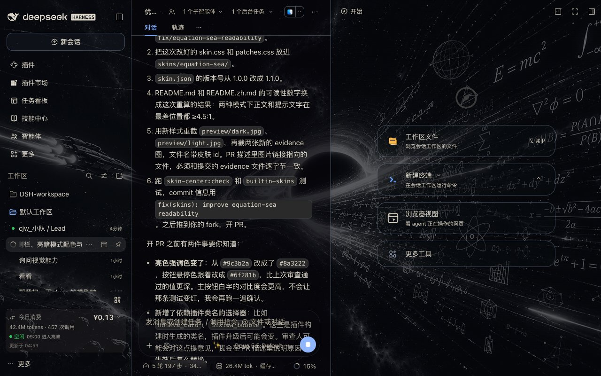
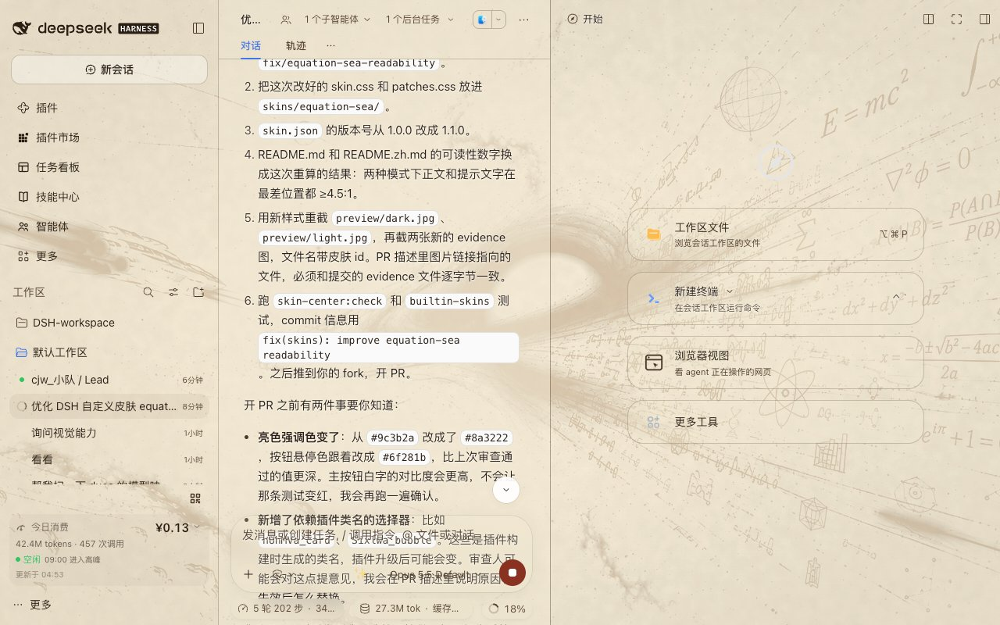

# Equation Sea

[中文](README.zh.md) | English

Turns the DSH Web GUI into a sea of equations: a black-hole accretion disk with
floating Euler formulas and Möbius strips behind the interface, with panels made
of glass whose thickness you can change. A pure asset directory — no
`package.json`, no build step; the skin center is the only loader.



## What it is

- **The backdrop stays visible, the text stays readable** — not by dimming the UI,
  but by trading "glass thickness" for legibility
- **Dark = black glass**: the canvas lays down one 46% scrim, then conversations
  and panels stack another 40–54% on top of it; the scrim slider deepens both
- **Light = parchment**: the same image turned into an ink line drawing on aged
  paper, with 26–44% white glass and near-black body text
- **The scrim slider drives everything**: every alpha is written as
  `calc(base + var(--dsw-skin-scrim) × delta)`, so the skin center's background
  scrim control keeps working on top of the skin, across the full 0–100% range
- **Code blocks are forced opaque** — the star field must not bleed into syntax
  highlighting
- **No `backdrop-filter` on the composer card** — per the host contract, adding it
  pushes tooltips into the scroll area; this skin uses a hairline inner shadow
  instead

## Readability

Computed with WCAG relative luminance, compositing every layer the host actually
paints: the manifest scrim, `--dsw-alias-bg-base` on the column, and this skin's
reading veil on top (`--eq-read-veil` for the conversation, `--eq-rail-veil` for
the right rail). Numbers are the worst pixel at the skin center's default scrim
of 0: in dark mode the brightest pixel of the accretion disk (#ffffff), in light
mode the darkest pixel of the parchment (about #858585).

| Mode | Area | Body | Secondary | Hint / caption | Dimmed |
|---|---|---|---|---|---|
| Dark | conversation | 7.0 : 1 | 5.3 : 1 | 4.75 : 1 | 4.6 : 1 |
| Dark | right rail | 5.2 : 1 | 4.9 : 1 | 4.7 : 1 | 4.7 : 1 |
| Light | conversation | 9.1 : 1 | 6.2 : 1 | 5.0 : 1 | 4.7 : 1 |
| Light | right rail | 7.8 : 1 | 5.3 : 1 | 5.0 : 1 | 5.0 : 1 |
| Both | market cards and sticky header | ≥ 9.7 : 1 | | | ≥ 5.4 : 1 |

Every text token clears AA (4.5 : 1) in every area, including directly over the
brightest part of the image. Dark-mode text is a warm ivory (`#dcd6ca`) rather
than a cold white, which keeps the contrast while cutting glare on the
black-and-white backdrop. The right rail is thinner than the conversation, so it
carries its own slightly stronger secondary tokens instead of thicker glass.

## Layering

- **Right rail is see-through.** The host paints `--dsw-alias-bg-base` twice on
  the right rail (the column and the dock tab host) and the skin used to add an
  18px blur on top. The rail now drops the blur and the second layer and keeps a
  single thin veil.
- **Cards stay above what they cover.** Market cards use
  `--dsw-alias-settings-card-fill` one step brighter and denser than the page,
  with a stroke and a drop shadow; the market's sticky header is near-opaque
  (98%) so a card scrolled under it never shows through its text.
- **User bubbles are distinct** from model replies through `--dsw-specific-bubble`
  and a hairline border.
- The market and chat rules match plugin CSS-module class names
  (`nUhMVa_`, `bkhjFa_`, `RcIGlq_`, `Sixlwa_`) with `[class~=...]`. A plugin
  release can rename them; if a rule stops applying, look up the new prefix in
  DevTools and replace it.

## Preview



## Files

```
skins/equation-sea/
├── skin.json      v2 manifest (light/dark backdrops + scrims)
├── skin.css       light/dark --dsw-* tokens + glass treatment
├── patches.css    hairlines, opaque code blocks, frosted settings modal, rail and card layering
├── NOTICE         asset and license statement
├── assets/        backdrop.jpg / backdrop-parchment.jpg
└── preview/       dark.jpg / light.jpg
```

## License and assets

- Stylesheets (`skin.css` / `patches.css` / `skin.json`): CC0-1.0
- Backdrop imagery: provided by the skin author and distributed with the skin;
  provenance and terms are in [NOTICE](NOTICE)

Upstream repository: https://github.com/Chenjiangwen/dsh-skin-equation-sea
