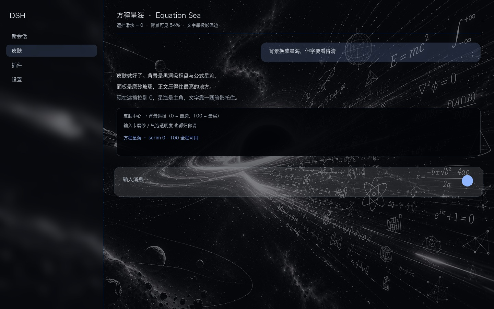
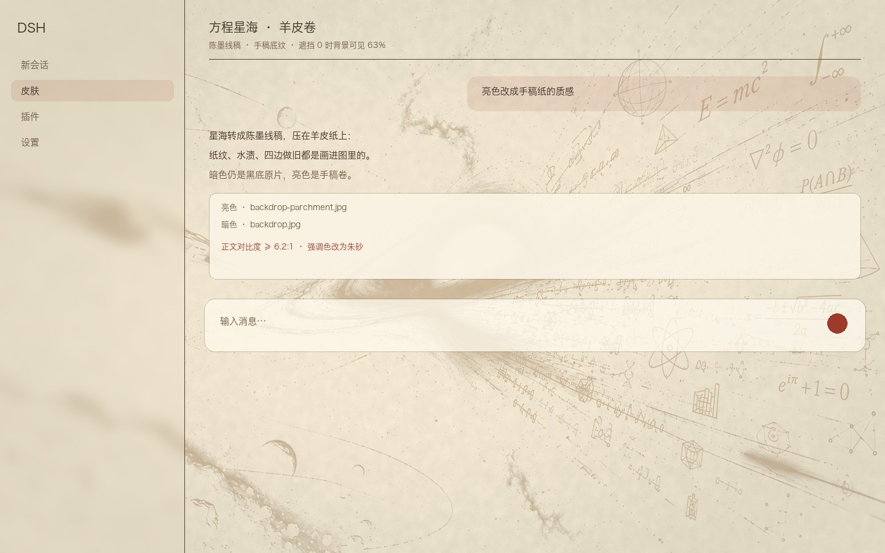

# Equation Sea

中文 | [English](README.md)

把 DSH Web GUI 变成一片**方程星海**：黑洞吸积盘、漂浮的欧拉公式与莫比乌斯环
当背景，面板是一层可以调厚度的玻璃。以纯资产目录形态收录，无 `package.json`、
无构建步骤，皮肤中心是唯一加载器。



## 是什么

- **背景看得见，字也看得清**：不靠把界面调暗，而是用「玻璃厚度」换可读性
- **暗色 = 黑玻璃**：画布先压一道 46%，会话与面板再叠 40–54%，两层都由遮挡滑块加深
- **亮色 = 羊皮卷**：同一张图转成陈墨线稿压在做旧纸面上，白雾玻璃 26–44%，正文近黑
- **遮挡滑块接管一切**：所有 alpha 写成 `calc(基础值 + var(--dsw-skin-scrim) × 增量)`，
  皮肤中心的「背景遮挡」滑块可以在皮肤自身的基础上继续加深，0–100% 全程可用
- **代码块强制不透明**：星海不许透进语法高亮里，否则配色全废
- **输入卡不加 `backdrop-filter`**：官方约定，加了会把 tooltip 推进滚动区；
  这里只给发丝内阴影

## 可读性

用 WCAG 相对亮度从 `skin.css` 的令牌 alpha 算，并按宿主自己的层叠结构合成：
外壳把 `--dsw-alias-bg-base` 铺在 frame 与中栏上，里面的面板再铺
`--dsw-alias-bg-layer-1..4`。所以背景是**穿过两层**才到文字底下，不是一层。
下表取每种模式里最薄的那一层：

| 模式 | 文字背后的背景 | 正文 | 次要文字 |
|---|---|---|---|
| 暗色 | 典型星海（90% 像素，≤ #4f4f4f） | ≥ 13.0 : 1 | ≥ 7.7 : 1 |
| 暗色 | 吸积盘最亮像素（#ffffff） | 6.0 : 1 | 3.6 : 1 |
| 亮色 | 羊皮卷最亮像素（#f6f6f6） | ≥ 11.2 : 1 | ≥ 5.6 : 1 |

AA 要求 4.5 : 1。正文在任何位置都过线，包括正压在背景最亮的像素上。唯一下
线的是次要文字，且只发生在吸积盘的镜面高光处（3.6 : 1）——那里由 `patches.css`
的文字投影保底，把皮肤中心的「背景遮挡」滑块推到约 20% 就能回到 AA 以上。

## 预览



## 文件

```
skins/equation-sea/
├── skin.json     v2 清单（亮/暗背景 + 遮罩）
├── skin.css      亮/暗 --dsw-* 令牌 + 玻璃质感
├── patches.css   发丝边、代码块不透明、设置模态磨砂
├── NOTICE        素材与授权说明
├── assets/       backdrop.jpg / backdrop-parchment.jpg
└── preview/      dark.jpg / light.jpg
```

## 许可与素材

- 样式表（`skin.css` / `patches.css` / `skin.json`）：CC0-1.0
- 背景图：皮肤作者提供，随本皮肤分发；来源与授权说明见 [NOTICE](NOTICE)

上游仓库：https://github.com/Chenjiangwen/dsh-skin-equation-sea
